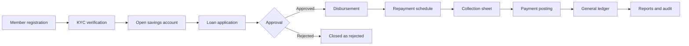
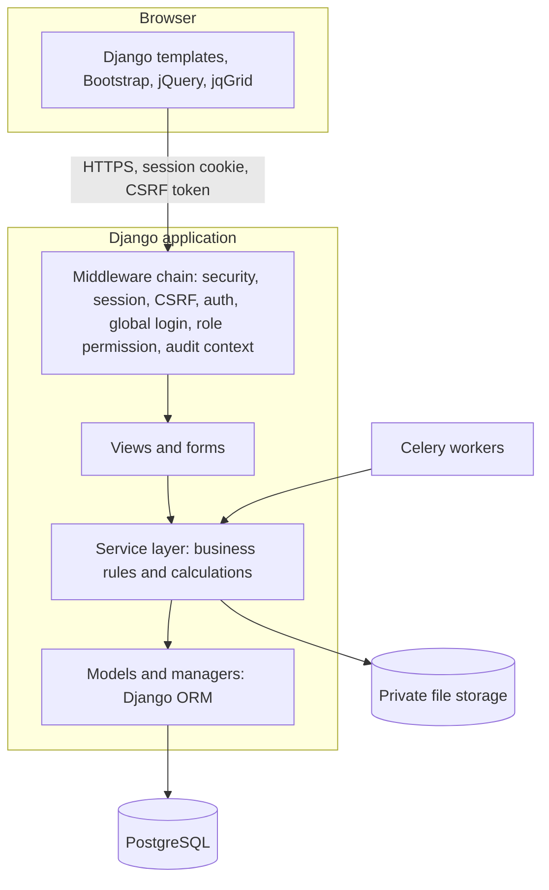
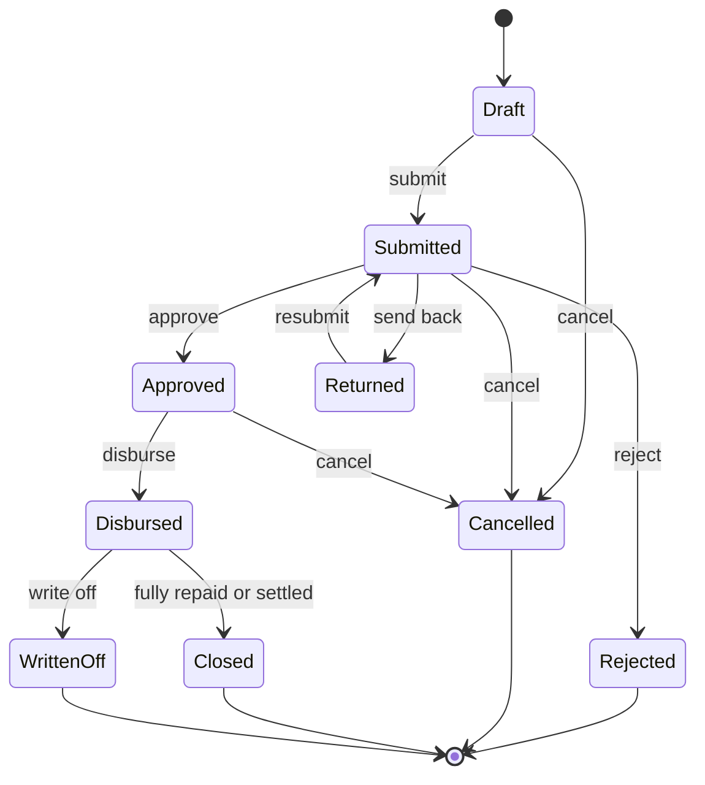
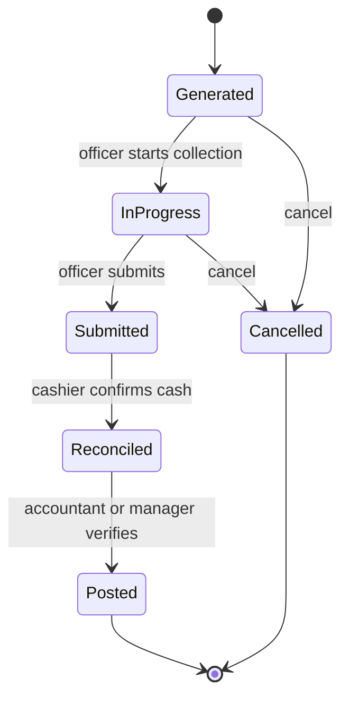
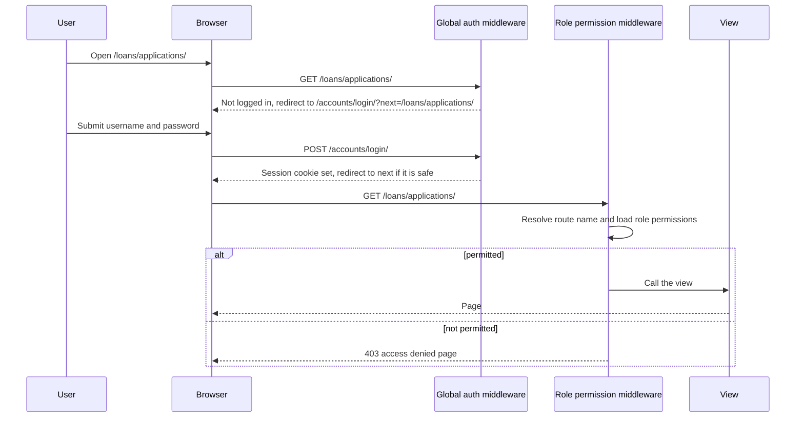
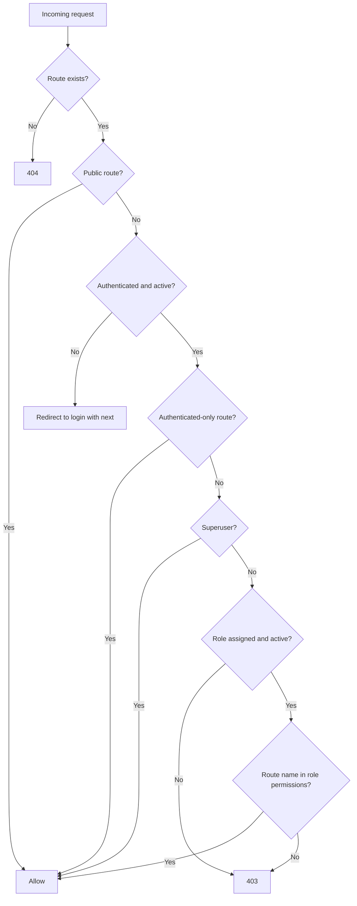
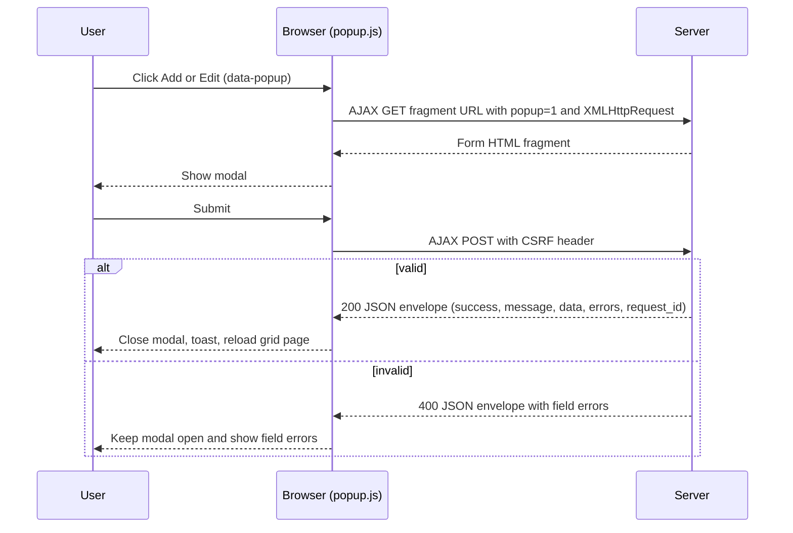
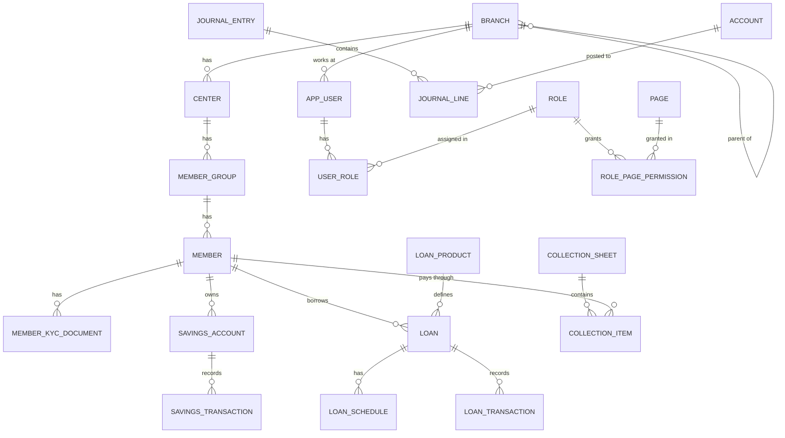

# ERP Management System

> A Django-based ERP platform, built toward a complete microfinance (MFI) management system: members, savings, loans, field collections, double-entry accounting, reporting, and a full audit trail, with security designed in from the start.

| | |
|---|---|
| **Status** | In development: Phase 7 part 2B is implemented and PostgreSQL-tested; other roadmap gaps remain |
| **Backend** | Python 3.12, Django 6.0.9 |
| **Database** | PostgreSQL |
| **Frontend** | Django templates, Bootstrap 5, jQuery, Free jqGrid, Bootstrap Icons |
| **Theme** | White and dark blue |
| **Last updated** | 2026-10-31 |

> **Placeholders to replace:** repository URL, license, maintainers and contact details are marked with `TODO`.

### How to read this document

Because the project is still growing, every feature is marked with its real status.

| Status | Meaning |
|---|---|
| **Implemented** | Exists in the codebase today |
| **Partial** | Basic version exists; listed items are still missing |
| **Planned** | Designed in this document, not built yet |

---

## Table of Contents

1. [Project Overview](#1-project-overview)
2. [Business Background](#2-business-background)
3. [Scope and Goals](#3-scope-and-goals)
4. [Users and Roles](#4-users-and-roles)
5. [Technology Stack](#5-technology-stack)
6. [System Architecture](#6-system-architecture)
7. [Functional Modules](#7-functional-modules)
8. [Business Rules and Calculations](#8-business-rules-and-calculations)
9. [Accounting Design](#9-accounting-design)
10. [Workflows](#10-workflows)
11. [Access Control (RBAC) and Security](#11-access-control-rbac-and-security)
12. [Branch Data Isolation](#12-branch-data-isolation)
13. [Audit and Compliance](#13-audit-and-compliance)
14. [Request and Response Design](#14-request-and-response-design)
15. [Database Design](#15-database-design)
16. [Frontend Design](#16-frontend-design)
17. [UX Standards](#17-ux-standards)
18. [Installation and Setup](#18-installation-and-setup)
19. [Configuration](#19-configuration)
20. [Testing](#20-testing)
21. [Deployment and Operations](#21-deployment-and-operations)
22. [Non-Functional Requirements](#22-non-functional-requirements)
23. [Roadmap](#23-roadmap)
24. [Development Conventions](#24-development-conventions)
25. [Glossary](#25-glossary)
26. [License and Contact](#26-license-and-contact)

---

## 1. Project Overview

### 1.1 What this project is

ERP Management System is a business and operational management application. Today it provides the **platform layer** every ERP needs: a dashboard, branch management, user management, role and URL-permission control, secure login, and a responsive Bootstrap interface with popup-based create and edit forms.

The goal is to grow this platform into a **complete microfinance ERP**. An MFI replaces paper registers and spreadsheets with one system covering the member lifecycle, savings, loans, center-based collections, the general ledger, management reports, and an audit trail that can stand up to an inspection.

### 1.2 Current state at a glance

| Area | Status | Notes |
|---|---|---|
| Dashboard / home | Implemented for current cards | Nine permission-aware, branch-scoped metrics; seeded-value and branch-scope tests cover every card |
| Login and logout | Implemented | Custom login view, redirect to dashboard |
| Global login-required redirect | Implemented | Anonymous users are sent to the login page |
| Route-based role permission check | Implemented | Uses the current Django route name; 403 page when denied |
| User management | Implemented | Create, list, edit, delete, assign a role |
| Role and permission management | Implemented | Role create, edit, list; URL checklist built from the Django URL resolver |
| Branch management | Partial | Create, list, search, edit, soft delete, jqGrid listing, hierarchy, branch switcher and explicit user branch grants |
| Popup (modal) create and edit | Done | Shared AJAX-fragment Bootstrap modal preserves frame denial; PostgreSQL tests cover fragments, login/permission checks and the save envelope |
| Success and error toasts (top middle, 5 seconds) | Implemented | Shared Django message partial and notification script; verify in browser before production |
| Security hardening | Partial | Phase 1 hardening is in place: env-based secrets, PostgreSQL config, middleware protections, default-deny routing, private media root, and Django-only ORM migrations |
| Organization hierarchy (head office, region, area, branch) | Partial | Hierarchy, branch scoping and organization screens exist; full isolation coverage and controls remain |
| Members | Partial | Member profiles, branch-prefixed codes, status history, photo/KYC handling, verification and scoped downloads |
| Savings | Partial | Product management, status controls and account term snapshots are PostgreSQL-verified; broader savings scope remains in progress; see [section 7.4](#74-savings) |
| Loans | Done | Requested Phase 5 workflows and reports pass the full PostgreSQL suite; see [section 7.5](#75-loans) |
| Collections | Done | Collection workflows, reports, exports, permissions, branch isolation, runtime immutability and maker-checker sheet reversal pass PostgreSQL tests |
| Accounting | Partial | Chart of accounts, fiscal periods, typed system mappings, balanced journals, approval, posting/reversal, account reconciliation and trial balance |
| Reports | Implemented for the listed catalog | 36 registered reports share branch-aware filters, jqGrid, totals, audited Excel/PDF exports and a permission-filtered index |
| Audit and compliance | Partial | Permissioned logs, record trails, system events, activity dashboard, compliance reports, ORM immutability and a PostgreSQL append-only trigger; producer coverage for background jobs and integrations remains |
| Settings module | Partial | Permissioned system, organization, user-preference and business-rule screens; translation catalogs and shared-cache deployment configuration remain |

### 1.3 Highlights (target system)

- **Multi-branch with hierarchy.** Head office, regions, areas and branches, each user seeing only the branches they are allowed to see.
- **Role-based access down to the URL.** Every role lists exactly which pages and actions (each Django route name is one permission) it may use.
- **Login-first.** Any URL opened without a valid session redirects to the login page, then returns the user to where they were going.
- **Double-entry accounting built in.** Savings, loan and collection transactions post to the general ledger automatically, inside one database transaction.
- **Field-friendly collections.** Collection sheets are generated per center or group and reconciled against cash handed in.
- **Complete audit trail.** Who did what, when, from where, with before and after values.
- **Security by default.** Default-deny permissions, hardened sessions, lockout, private file storage, secrets outside the code. See [section 11](#11-access-control-rbac-and-security).
- **Careful UX.** Create and edit forms open in popups, success and error messages appear at the top middle of the screen for 5 seconds, and the interface uses a clean white and dark blue theme.

---

## 2. Business Background

### 2.1 What microfinance is

Microfinance institutions provide small loans and basic financial services (savings, sometimes insurance) to people and small businesses that traditional banks usually do not serve. Loans are small, repaid in frequent short installments, and often rely on group trust instead of heavy collateral.

### 2.2 How a typical MFI operates

```
Head Office
  └── Region / Area
        └── Branch
              └── Center (a meeting place and schedule)
                    └── Group (a small set of members)
                          └── Member
```

- A **field officer** (loan officer) is responsible for one or more centers.
- Members meet at their center on a fixed day, usually weekly or bi-weekly. The field officer collects **loan installments** and **savings deposits** there.
- Many MFIs require **compulsory savings** alongside a loan.
- Loans run in **cycles**: a member who repays well becomes eligible for a larger amount next cycle.
- Collected cash is handed to the branch cashier, who reconciles it against the collection sheet, and the accountant posts it to the books.

### 2.3 Problems this system solves

| Problem with paper or spreadsheets | How the ERP addresses it |
|---|---|
| Calculation mistakes in interest and installments | One tested calculation engine, schedules generated by the system |
| Delayed or missing reconciliation | Collection sheets reconciled and posted to the ledger the same day |
| No real-time view of overdue loans | Live portfolio-at-risk (PAR) and overdue dashboards |
| Weak accountability | Immutable audit log of every important action |
| Data leaking between branches | Branch-level data isolation enforced in the backend |
| Slow month-end closing | Trial balance and financial statements at any time |

### 2.4 End-to-end business process



---

## 3. Scope and Goals

### 3.1 Goals

1. Give every branch a reliable daily operating tool for members, savings, loans and collections.
2. Give management accurate, timely financial and portfolio information.
3. Make every financial figure traceable to a transaction, and every transaction traceable to a person.
4. Keep the system simple enough for field and branch staff to use with minimal training.
5. Treat security and data integrity as features, not afterthoughts: this system holds personal data and money.

### 3.2 In scope (version 1)

Authentication, Branches, Members, Savings, Loans, Collections, Accounting, Reports, Audit, Settings, plus the supporting modules in [section 7.11](#711-additional-recommended-modules): centers and groups, staff, products, dashboard, day-end closing, holiday calendar, and notifications.

### 3.3 Out of scope (version 1)

- Native mobile app for field officers
- Mobile wallet or payment gateway integration
- Credit bureau integration
- Payroll, HR and fixed-asset accounting
- Insurance product management
- Public REST API (a Django REST Framework API is a later option)

These are listed again in the [Roadmap](#23-roadmap).

---

## 4. Users and Roles

Roles are fully configurable. The table shows the **suggested default roles** that are seeded on first run.

| Role | Typical user | Typical access |
|---|---|---|
| Super Admin | System owner | Everything, including roles, users and system settings. Cannot be deleted. |
| Admin | Head office IT or operations | Users, roles, settings, all branches |
| Branch Manager | Branch head | Approvals, branch reports, branch staff, own branch only |
| Accountant | Branch or head office accountant | Chart of accounts, journals, reconciliation, financial reports |
| Cashier | Branch cashier | Receive collections, savings deposits and withdrawals, cash book |
| Field Officer | Loan officer | Own centers: members, collection sheets, loan applications |
| Auditor | Internal or external auditor | Read-only access to data, reports and audit logs |

> A user is assigned a role. The data model also allows multiple roles per user, in which case the effective permissions are the union of all assigned roles.

---

## 5. Technology Stack

### 5.1 Current stack

| Concern | Choice |
|---|---|
| Language | Python 3.12 |
| Framework | Django 6.0.6 (pin the exact version in `requirements.txt`) |
| Database | PostgreSQL |
| Database driver | `psycopg2-binary` (fine for development; for production consider `psycopg` 3 or a source-built `psycopg2`) |
| Authentication | Django auth with a custom user model (`CustomUser`, table `auth_user`) |
| Authorization | Custom middleware, role and permission tables, route-name checks |
| ORM and migrations | Django ORM and Django migrations only |
| Templates | Django templates |
| UI | HTML5, CSS3, Bootstrap 5, Bootstrap Icons |
| Scripting | jQuery, Free jqGrid |

### 5.2 Planned additions

| Concern | Choice |
|---|---|
| Settings and secrets | Environment variables (`django-environ` or `python-dotenv`), split settings (`base`, `dev`, `prod`) |
| Password hashing | Argon2 via `argon2-cffi` |
| Brute-force protection | `django-axes` |
| Content Security Policy | `django-csp` |
| Admin MFA (later) | `django-otp` or an equivalent |
| Static files | WhiteNoise or Nginx |
| Application server | Gunicorn behind Nginx (TLS) |
| Background jobs | Celery with Redis (interest posting, day-end, notifications, large exports) |
| Cache | Redis (permission cache, sessions optional) |
| Excel export | `openpyxl` |
| PDF export | WeasyPrint or ReportLab |
| Image handling | Pillow (validate and re-encode member photos) |
| Testing | `pytest`, `pytest-django`, `factory_boy`, Playwright for end-to-end |
| Quality and security tooling | `ruff`, `black`, `bandit`, `pip-audit`, optional `mypy` |
| Logging and monitoring | Structured logging, optional Sentry |
| CI/CD | GitHub Actions or similar |

### 5.3 Architecture decision: one ORM

**Implemented:** application models use the **Django ORM and Django migrations**. SQLAlchemy and Alembic have been retired so financial postings, balances and audit records share Django transaction boundaries. Continue to use Django migrations for every schema change.

---

## 6. System Architecture

### 6.1 High-level view



### 6.2 Layers

| Layer | Responsibility | Rule |
|---|---|---|
| **Middleware** | Security headers, session, CSRF, authentication, global login redirect, role permission check, audit context | Runs before any view; default deny |
| **Views and forms** | Read the request, validate input with forms, call a service, return HTML or JSON | Thin: no business rules here |
| **Services** (`service.py` per app) | Business rules: eligibility, calculations, state transitions, postings | Everything that changes money runs inside `transaction.atomic()` |
| **Models and managers** | Data, constraints, branch-scoped managers | Constraints in the database, not only in Python |
| **Templates and static** | Presentation | Escaped output, no business logic |

The branch app already follows this idea with `core/branch/service.py` for CRUD. The same pattern is used for every new module.

### 6.3 Project structure

Entries marked *(planned)* do not exist yet.

```
ERP_Project/
├── ERP/
│   ├── settings.py            # (planned) split into settings/base.py, dev.py, prod.py
│   ├── urls.py
│   ├── views.py               # dashboard / home
│   ├── db.py                  # SQLAlchemy engine (retired after ORM consolidation)
│   ├── wsgi.py
│   └── asgi.py
├── core/
│   ├── accounts/              # users, roles, permissions, login, middleware
│   │   ├── models.py          # CustomUser
│   │   ├── forms.py
│   │   ├── global_auth_middleware.py
│   │   ├── middleware.py
│   │   ├── permission_utils.py
│   │   ├── urls.py
│   │   ├── utils.py
│   │   └── views.py
│   ├── branch/                # branch CRUD
│   │   ├── models.py
│   │   ├── service.py
│   │   ├── urls.py
│   │   └── views.py
│   ├── common/                # shared branch-scoped managers and request context
│   ├── members/               # (planned)
│   ├── savings/               # savings products, accounts, ledger transactions and interest
│   ├── loans/                 # (planned)
│   ├── collections/           # sheets, field entries, reconciliation and reports
│   ├── accounting/            # chart of accounts, journal engine and reconciliation
│   ├── reports/               # registered report definitions, filters and exports
│   ├── audit/                 # append-only ORM audit log
│   └── configuration/         # (planned) system, organization, business rules
├── templates/
│   ├── base.html
│   ├── home.html
│   ├── accounts/
│   ├── branch/
│   ├── registration/
│   └── partials/              # (planned) toasts, modal shell, grid helpers
├── static/
│   ├── css/style.css
│   └── js/                    # script.js, popup.js, (planned) notify.js
├── database/
│   └── change_query.psql      # manual SQL for the branches table (to become a Django migration)
├── tests/                     # (planned)
├── requirements.txt
├── manage.py
├── alembic.ini                # retired after ORM consolidation
├── .env.example               # (planned)
├── .gitignore
└── README.md
```

`db.sqlite3` and `.venv/` must **not** be committed. See [section 24](#24-development-conventions).

### 6.4 Request lifecycle

1. The browser sends an HTTPS request with the session cookie (and the CSRF token for non-GET requests).
2. Django security, session, CSRF and authentication middleware run first.
3. The **global auth middleware** sends anonymous users to the login page.
4. The **role permission middleware** resolves the route name and checks it against the user's role (default deny).
5. The view validates input with a form and calls a service.
6. The service applies business rules inside `transaction.atomic()`. Branch-scoped managers restrict every query to the user's accessible branches.
7. Audit records are written in the same transaction.
8. The response is HTML, or JSON for AJAX calls (see [section 14](#14-request-and-response-design)). Django messages or the JSON `message` field become a toast.

---

## 7. Functional Modules

Each module lists its features, key rules, and main screens. All create and edit forms open in a **popup dialog**; list and detail pages are normal routes.

### 7.1 Authentication

**Status:** Partial. Implemented: login, logout, user create, list, edit and delete, role assignment, role create, edit and list with a URL checklist, global login redirect, route-based permission check. Planned: password change and reset, forced change on first login, password policy, lockout, session idle timeout, role delete, permission matrix with action columns, MFA for admins.

**Features**

- Login with username or email and password; logout
- Forgot password and reset password through an emailed, time-limited, single-use link
- Change password (requires the current password)
- Forced password change on first login and after an admin reset
- Role assignment to users, and role management with a permission matrix
- User management: create, edit, activate or deactivate, unlock, reset password

**Rules**

- Password policy is configurable (minimum length, upper and lower case, digit, symbol, history of the last N passwords, expiry in days).
- Account locks after a configurable number of failed attempts (default 5) for a configurable time (default 15 minutes).
- Logout flushes the server-side session and redirects to the login page.
- Every login, failed login, logout, lockout and password change is audited.

**Screens**: `/accounts/login/`, `/accounts/password/reset/`, `/accounts/password/change/`, `/accounts/users/`, `/accounts/roles/`

### 7.2 Branches

**Status:** Partial. Implemented: create, list, search, edit, soft delete (`is_active`), jqGrid listing. Planned: hierarchy, branch type, parent, address and contact fields, business date, data isolation, deactivation rules, branch switcher.

**Features**

- Create and manage multiple branches
- Branch hierarchy: Head Office → Region → Area → Branch (a self-referencing tree)
- Tree view and list view; move a branch under a different parent
- Branch-specific data isolation (see [section 12](#12-branch-data-isolation))
- Branch switcher for users who can access more than one branch

| Field | Notes |
|---|---|
| Code | Unique, short, used in member and account numbers |
| Name | Required |
| Type | HeadOffice, Region, Area, Branch |
| Parent branch | Required except for the head office |
| Address, phone, email | Optional |
| Opening date | Used in reports |
| Branch manager | A staff member |
| Business date | The current working date of the branch (see day-end closing) |
| Status | Active or Inactive |

**Rules**

- A branch cannot be deactivated while it has active loans, open collection sheets, or unposted transactions.
- Branch code cannot change once transactions exist.

**Screens**: `/branch/`

### 7.3 Members

**Status:** Partial. Implemented: member profiles, branch-prefixed codes, member status history, photo/KYC handling, verification and scoped downloads. Full lifecycle and isolation coverage remain.

**Features**

- Member registration with **photo upload**
- Member profile management
- Member status tracking: **Active**, **Inactive**, **Suspended**
- **KYC documentation**
- Assign a member to a center and group
- Member history: savings, loans, collections, status changes

| Field group | Fields |
|---|---|
| Identity | Member code (auto: `{BranchCode}-{sequence}`), full name, father's name, mother's name, spouse's name, date of birth, gender, marital status |
| Contact | Phone, alternate phone, email, present address, permanent address |
| Identification | National ID number, other ID numbers |
| Economic | Occupation, monthly income range, household size |
| Nominee | Name, relationship, phone, ID, share percentage |
| Membership | Branch, center, group, admission date, admission fee |
| Photo | JPG or PNG, size limit configurable (default 2 MB) |

**KYC documents**

- Document types are configurable: national ID, birth certificate, passport, driving license, utility bill, other
- Each document has: type, number, issue and expiry date, file upload, status (Pending, Verified, Rejected), verified by and when, rejection reason
- A member can be configured to require at least one verified identity document before a loan is approved

**Status rules (defaults, configurable in business rules)**

| Action | Active | Inactive | Suspended |
|---|---|---|---|
| New loan application | Allowed | Blocked | Blocked |
| Savings deposit | Allowed | Allowed | Blocked |
| Savings withdrawal | Allowed | Blocked | Blocked |
| Repayment of an existing loan | Allowed | Allowed | Allowed |

- Every status change needs a **reason** and is audited.
- Photos and documents are stored outside the public web root and served only through an authorized endpoint. File type is checked by content, not just by extension. See [section 11.9](#119-secure-file-handling-photos-and-kyc-documents).

**Screens**: `/members/`, `/members/<id>/`, `/members/kyc/`

### 7.4 Savings

**Status:** Partial. Implemented: general and compulsory products, product list/create/edit/status management, account term snapshots, individual and group accounts, member-wise group contributions, deposits, withdrawals, product fees, maker-checker withdrawal approval, reversals, daily/minimum-balance interest with withholding tax, automatic ledger postings, account statements, and a branch-scoped balance report. Product changes do not alter terms already copied to accounts. Automated scheduling and optional transfers remain outside the completed scope.

**Features**

- Create **individual** and **group** savings accounts
- Track savings transactions
- Generate savings reports and statements
- **Interest calculation** where the product pays interest

**Savings products** define: name, code, type (general or compulsory), annual interest rate and method, posting frequency, minimum opening balance and balance, withdrawal limits, fees, optional withholding tax, dormancy days, dormant-account interest treatment, and active status.

**Accounts**

- Account number is generated per branch (`{BranchCode}-{ProductCode}-{sequence}`).
- An **individual** account belongs to one member.
- A **group** account belongs to a group and keeps a member-wise contribution ledger.
- Status: Pending, Active, Dormant, Closed.

**Transactions**: Deposit, Withdrawal, Interest posting, Fee, Transfer (optional), Reversal.

**Rules**

- No overdraft: a withdrawal cannot exceed the available balance minus the minimum balance.
- Withdrawals above a configurable amount need approval (maker-checker).
- Posted transactions are never edited or deleted. A mistake is corrected with a **reversal** transaction that references the original.
- Interest method and posting frequency are set per product (see [section 8.2](#82-savings-interest)).

**Screens**: `/savings/products/`, `/savings/accounts/`, `/savings/transactions/`, `/savings/accounts/<id>/statement/`, `/savings/reports/balances/`

Configure the `cash_in_hand`, `bank_accounts`, `member_savings`, `interest_expense`, `withholding_tax_payable`, and `fee_income` system-account mappings before posting the corresponding transactions. Interest periods must match the product's calendar posting frequency. A scheduler can invoke the command, for example:

```bash
python manage.py post_savings_interest \
  --actor <active-user-with-branch-access> \
  --start-date 2025-01-01 \
  --end-date 2025-01-31
```

### 7.5 Loans

**Status: Done for the requested Phase 5 scope.** Verified on PostgreSQL with `pytest -vv`: 102 passed, 192 subtests passed, zero failures, zero errors and zero skips (2026-10-30).

| Phase 5 requirement | Status | Passing PostgreSQL test evidence |
|---|---|---|
| Loan statement/history: versioned schedules, payments, penalties, balances, PAR, status history, printable and branch-scoped | Done | `test_statement_history_and_classification_exports_render`; `test_branch_scope_blocks_forged_ids_for_loan_lifecycle_routes`; `test_every_loan_route_is_denied_without_its_permission` |
| Guarantors/collateral, product-required validation and audit | Done | `test_guarantor_and_collateral_requirements_are_validated_and_audited` |
| Approval tiers by role and branch level; maker cannot approve | Done | `test_approval_tier_limits_are_applied_by_role_and_branch_level`; `test_maker_checker_disbursement_posts_once_with_balanced_ledger` |
| Refund or savings-transfer overpayment handling, atomic/idempotent and ledger-posted | Done | `test_overpayment_refund_is_atomic_idempotent_and_ledger_posted`; `test_overpayment_savings_transfer_posts_once_to_member_account` |
| Per-product full, pro-rata and waived-interest settlement; waiver permission, reason and audit | Done | `test_full_and_pro_rata_settlement_policies_are_distinct`; `test_early_settlement_waives_unearned_interest_and_posts_fee`; `test_early_settlement_waiver_requires_permission_and_reason` |
| Separate insurance-fee accounting mapping | Done | `test_disbursement_fees_are_deducted_and_credited_separately` |
| Configurable PAR classification/provisioning with Excel and PDF export | Done | `test_classification_report_uses_configured_par_buckets`; `test_statement_history_and_classification_exports_render` |
| Branch A cannot list/open/approve/disburse/repay/reschedule/settle/write off/recover/view branch B loans with forged IDs | Done | `test_branch_scope_blocks_forged_ids_for_loan_lifecycle_routes` |
| Golden flat and declining schedules balance principal plus interest | Done | `test_flat_golden_schedule_rounds_last_installment_and_balances`; `test_declining_golden_schedule_has_expected_first_installment_and_totals` |
| Concurrent repayment retry, idempotency and ledger balance | Done | `test_concurrent_retries_of_full_repayment_create_one_payment`; `test_repayment_is_locked_atomic_idempotent_and_posts` |
| Penalty assessment/cap/allocation and reschedule version integrity | Done | `test_late_penalty_is_assessed_capped_and_allocated_before_interest`; `test_reschedule_preserves_old_version_and_is_idempotent` |
| Disbursement/repayment fee ledger balance and rollback on missing mapping | Done | `test_disbursement_fees_are_deducted_and_credited_separately`; `test_missing_mapping_rolls_back_disbursement_and_draft_journal` |
| Runtime-role immutability for posted loan payments/history | Done | `test_runtime_role_cannot_update_or_delete_posted_loan_payments` |
| All loan routes permission-checked; state-changing actions reject GET | Done | `test_every_loan_route_is_denied_without_its_permission`; `test_get_is_not_allowed_on_state_transition_routes` |

**Features**

- Loan application processing
- Loan approval and disbursement
- Payment tracking and collection
- Loan status monitoring
- Interest and principal calculation

**Loan products** define: name, code, interest method (flat or declining balance), annual interest rate, min and max amount, min and max term, installment frequency (weekly, bi-weekly, monthly), processing and insurance fees, grace period, penalty rules, required compulsory savings, loan cycle limits, maximum concurrent loans, guarantor/collateral requirements, overpayment policy and settlement policy. New loans snapshot product terms at disbursement.

| Earlier delivery requirement | Status | Passing PostgreSQL test evidence |
|---|---|---|
| One AJAX-fragment Bootstrap modal for Branch, Users, Roles, Members, Savings, Loans and Accounting | Done | `test_ajax_popup_routes_return_fragments_and_keep_frame_denial`; `test_popup_routes_require_login_and_route_permission`; `test_popup_save_uses_standard_json_envelope_for_success_and_validation` |
| Savings Product list/create/edit/status actions, validation, audit and role permissions | Done | `test_savings_product_crud_status_filter_and_audit`; `test_savings_routes_are_denied_without_explicit_permission` |
| Loan Product list/create/edit/status actions, validation, audit and role permissions | Done | `test_loan_product_crud_status_filter_and_audit`; `test_every_loan_route_is_denied_without_its_permission` |
| Existing savings accounts and loans retain copied product terms after product edits | Done | `test_existing_account_keeps_product_terms_after_product_change`; `test_disbursed_loan_keeps_the_product_terms_copied_at_creation` |

**Application**

- Member, product, requested amount, term, installment frequency, purpose
- Guarantors and collateral (optional per product)
- Loan cycle number and previous loan history are shown automatically
- Eligibility checks run when the application is submitted:
  - Member is Active and KYC requirement is met
  - No overdue installments on any other loan
  - Within the maximum number of concurrent loans
  - Requested amount within the cycle limit for that member
  - Required savings balance is met

**Approval**

- Approval levels depend on the loan amount (for example Branch Manager up to a limit, Area or Region above it). Limits are set in business rules.
- The approver can approve, reject, or send back with a comment. Approved amount may be lower than requested.

**Disbursement**

- Channel: cash, bank, or transfer to the member's savings account
- Fees and insurance can be deducted at disbursement or charged separately
- The system generates the repayment schedule and posts the accounting entry automatically
- Available channels in this phase are cash and bank. Savings-account transfers are not yet available.

**Lifecycle after disbursement**

- **Repayment** and **early settlement**
- **Rescheduling** (new schedule, old schedule kept in history)
- **Write-off** and later **recovery**
- **Closure** when the outstanding balance reaches zero

**Statuses**: Draft, Submitted, Returned, Approved, Rejected, Disbursed (Active), Closed, WrittenOff, Cancelled. *Overdue* is a calculated flag, not a status.

**Screens**: `/loans/products/`, `/loans/applications/`, `/loans/disbursements/`, `/loans/portfolio/`, `/loans/repayments/`

### 7.6 Collections

**Status:** Done for the requested Phase 6 scope, including maker-checker reversal of posted sheets. PostgreSQL evidence: `test_collection_sheet_reversal_restores_loan_and_nets_journal_once`, `test_collection_sheet_reversal_is_safe_under_concurrent_approval`, `test_collection_sheet_reversal_rejects_closed_accounting_period`, `test_runtime_role_cannot_mutate_posted_sheets_or_rows`, and the collection route, branch-isolation, posting, reconciliation and export tests.

**Features**

- Create collection sheets
- Track payments from members
- Generate collection reports
- Payment reconciliation

**How it works**

1. The system **generates a collection sheet** for a center (or group), a collection date, and a field officer. It lists every member with the loan installment due, any overdue amount, and the savings amount expected.
2. The field officer collects money at the meeting and records the **amount actually collected** per member (full, partial, or none, with a reason).
3. The sheet is **submitted**. The cashier receives the cash and enters the **cash received**.
4. The system compares collected against received and records any **shortage or excess**.
5. The accountant or branch manager **verifies** the sheet. The reconciled sheet is then posted atomically; repayments and savings deposits reuse the loan and savings posting services, and any cash variance is journaled.

**Sheet statuses**: Generated, InProgress, Submitted, Reconciled, Posted, Cancelled.

**Rules**

- A payment allocation follows the configured order (default: penalty, fees, interest, principal). See [section 8.4](#84-repayment-allocation).
- Double submission is prevented with an idempotency key, so a slow network or double click cannot post a payment twice.
- A posted sheet and its rows are locked by the ORM and PostgreSQL runtime-role triggers. Collection-level reversal and correction workflow remains incomplete.

**Screens**: `/collections/sheets/`, `/collections/reconciliation/`

**Verification:** Full PostgreSQL run on 2026-10-30: 115 passed, 223 subtests passed, zero failures, zero errors and zero skips. Collection-specific tests include `test_generation_is_idempotent_and_includes_expected_installment`, `test_partial_collection_requires_reason_and_posts_allocation`, `test_full_and_advance_payments_use_existing_loan_allocation`, `test_two_verifiers_and_same_key_post_a_sheet_only_once`, `test_savings_deposit_and_loan_journals_equal_the_sheet_total`, `test_failed_row_rolls_back_every_sheet_posting`, `test_runtime_role_cannot_mutate_posted_sheets_or_rows`, `test_lifecycle_rejects_bad_transitions_and_collector_cannot_verify`, `test_reconciliation_variances_post_to_mapped_accounts`, `test_every_collection_route_requires_its_explicit_permission`, `test_state_changing_routes_reject_get`, `test_collection_entry_screen_renders_live_total_and_unsaved_warning`, and `test_forged_branch_ids_cannot_open_enter_submit_reconcile_post_or_export`.

### 7.7 Accounting

**Status:** Partial. Account, period, typed system-account, journal, reconciliation and trial-balance workflows exist; savings, loan and collection subledger postings are automated. Fiscal-year close controls and account-level drill-down remain.

**Features**

- Chart of accounts management
- Journal entry creation
- Double-entry bookkeeping
- Account reconciliation
- Trial balance

**Chart of accounts**

- Hierarchical, with account types: Asset, Liability, Equity, Income, Expense
- Each account has a code, name, parent, type, normal balance (debit or credit), and whether it allows direct posting
- **System accounts** (for example Cash in Hand, Loans to Members, Member Savings, Interest Income) are mapped in settings so automatic postings know where to post

**Journal entries**

- Manual vouchers: journal, cash, bank (separate voucher number series)
- Automatic entries from savings, loans and collections
- Each entry has a date, narration, reference to its source transaction, and two or more lines
- **An entry cannot be saved unless total debits equal total credits**
- Posted entries are immutable. Corrections use a reversing entry.
- Manual entries can require approval before posting

**Reconciliation**

- Cash book against physical cash count
- Bank accounts against bank statements
- Subledger to ledger: total of all loan balances equals the *Loans to Members* account, total of all savings balances equals the *Member Savings* account

**Trial balance**

- For a date or date range, by branch or consolidated for the head office
- Shows opening, debit, credit and closing columns, and a check that total debits equal total credits
- Drill down from an account to its journal lines

**Fiscal year and periods**: a fiscal year contains periods (months). A closed period rejects new postings.

**Screens**: `/accounting/chart-of-accounts/`, `/accounting/journal-entries/`, `/accounting/reconciliation/`, `/accounting/trial-balance/`, `/accounting/fiscal-years/`

### 7.8 Reports

**Status:** Implemented for the catalog below. Each report is declared in a shared registry with columns, queryset, applicable filters, totals and a dedicated page/grid/Excel/PDF permission. The role-filtered `/reports/` index links only to reports the user may open. Grid data is server-paged and sorted; exports carry organization and filter labels and are audited. Without a background runner, Excel streams and Excel/PDF exports are capped at 5,000 rows with a filter-narrowing response.

All report pages expose common branch, center, field-officer, date-range and status controls; definitions apply only the filters meaningful to their underlying data. Head-office users can consolidate across accessible branches.

| Group | Reports |
|---|---|
| Member | Member list, new members, status summary, KYC pending or expired, member statement |
| Savings | Account list, transaction register, balance summary, interest posted, dormant accounts |
| Loan | Disbursement register, outstanding loans, overdue loans, portfolio at risk (PAR), loan aging, loan statement, write-offs, repayment schedule, loan classification |
| Collection | Collection sheet, daily collection summary, collector performance, collection efficiency, shortage and excess |
| Financial | Trial balance, general ledger, cash book, income statement, balance sheet, receipts and payments |
| Compliance | User access review, role/permission history, privileged actions, failed logins/lockouts, reopened days/reversals, KYC completeness |

**Screens**: `/reports/` and `/reports/<report-slug>/`, with `/data/`, `/export/excel/` and `/export/pdf/` endpoints per registered report.

**PostgreSQL evidence:** `test_financial_reports_balance_and_match_posted_ledger`, `test_loan_reports_match_disbursement_schedule_overdue_and_writeoff_data`, `test_collection_reports_share_the_posted_sheet_source_and_totals`, and the parameterized permission, branch-forgery and audited Excel/PDF tests for every registered report.

### 7.9 Audit

**Status:** Partial. Permissioned audit logs, record trails, system events, activity dashboard and shared-framework compliance reports are implemented. The ORM rejects updates/deletes and a PostgreSQL trigger plus runtime-role grants protect `audit_logs`. Successful POST mutations are audited inside the request transaction; failed mutations roll back. Background job and integration event producers and exhaustive event-specific coverage remain.

**Features**

- User activity logging
- System event tracking for request errors and lockouts; the event service accepts job and integration events when producers are added
- Audit trail generation (who changed what, with before and after values)
- Compliance reporting
- Activity dashboard

Details are in [section 13](#13-audit-and-compliance).

**Screens**: `/audit/logs/`, `/audit/events/`, `/audit/trail/<entity>/<id>/`, `/audit/dashboard/`; compliance reports are in `/reports/`

**PostgreSQL evidence:** `AuditScreenTests.test_audit_screens_and_record_trail_require_permissions`, `AuditScreenTests.test_audit_search_and_activity_dashboard_are_branch_scoped`, `AuditScreenTests.test_axes_lockout_signal_creates_audited_system_activity`, `AuditScreenTests.test_member_sensitive_read_is_audited_without_copying_identifier_values`, and `AuditLogTests.test_postgresql_trigger_rejects_direct_audit_log_mutation`.

### 7.10 Settings

**Status:** Partial. Each screen has its own route permission; system and organization changes are validated, cached and audited with old/new values. User preferences are self-only and affect report page size, landing page and date display; the selected language is applied, but translation catalogs remain incomplete. Business-rule screens reuse product, approval-tier and PAR-bucket controls instead of duplicating them. Multi-process deployments should configure a shared Django cache backend for cross-worker invalidation.

| Group | What it controls |
|---|---|
| **System configuration** | Application name and logo, currency and number format, date format, time zone, fiscal year start, password policy, session timeout and file upload limits. Notification schedule and templates are separately editable under Settings. Mail/SMS credentials remain in environment variables and are not stored in the database. |
| **Organization settings** | Legal name, registration number, address, phone, email, website and logo in report/print headers; regulator details remain future work |
| **User preferences** | Per-user: language, default page size, default landing page, date format |
| **Business rules configuration** | Loan and savings limits, approval limits, penalty rules, repayment allocation order, PAR thresholds, member status rules, collection rules, rounding rules |

Changes to settings are audited with old and new values.

**Screens**: `/settings/system/`, `/settings/organization/`, `/settings/business-rules/`, `/settings/preferences/`, `/settings/notifications/templates/`

**PostgreSQL evidence:** `ConfigurationRouteTests.test_settings_screens_and_mutations_require_their_own_permission`, `ConfigurationRouteTests.test_settings_mutation_routes_reject_get`, `ConfigurationRouteTests.test_settings_index_lists_only_screens_the_user_can_open`, `ConfigurationRouteTests.test_system_configuration_is_validated_audited_and_effective_immediately`, `ConfigurationRouteTests.test_user_preferences_only_update_the_logged_in_user`, `ConfigurationRouteTests.test_every_settings_mutation_route_writes_a_request_audit`, and `ConfigurationRouteTests.test_settings_change_rolls_back_when_its_audit_write_fails`.

**Full PostgreSQL validation:** `pytest -q` — 1,689 passed, 278 subtests passed, zero failures, zero errors and zero skips (2026-10-31).

**Phase 7 part 2B PostgreSQL evidence:** `test_every_route_audits_successful_state_changing_requests`, `test_authentication_audit_exemptions_have_documented_producers`, `RoutePermissionTests.test_permission_revocation_is_immediate_across_clients_with_shared_cache_config`, `ConfigurationRouteTests.test_settings_are_read_from_database_when_shared_cache_is_unavailable`; notification coverage includes `test_daily_job_generates_all_four_event_types`, `test_notification_generation_is_idempotent_per_recipient_event_and_day`, `test_notification_opt_out_is_respected`, `test_delivery_respects_opt_out_changed_after_notification_creation`, `test_sms_uses_console_provider_without_logging_recipient_data`, `test_provider_failure_retries_and_records_job_and_integration_events`, `test_unexpected_job_failure_is_recorded_and_propagated`, `test_recipients_are_limited_to_the_event_branch`, `test_template_placeholders_are_validated`, `test_every_notification_route_requires_its_permission`, and `test_notification_mutation_routes_reject_get`; import coverage includes `test_validation_reports_row_level_errors`, `test_validated_import_rolls_back_every_row_on_late_failure`, `test_upload_is_idempotent_by_file_hash`, `test_branch_isolation_rejects_foreign_savings_accounts`, `test_savings_opening_import_is_maker_checker_and_posts_balanced_journal`, `test_gl_opening_import_posts_one_balanced_journal_after_checker_approval`, `test_unbalanced_gl_opening_is_rejected_before_approval`, `test_malicious_uploads_are_rejected`, `test_row_limit_is_enforced`, `test_validation_error_download_neutralizes_formula_cells`, `test_every_import_route_requires_its_permission`, and `test_every_import_mutation_route_rejects_get`.

### 7.11 Additional recommended modules

**Status:** Dashboard cards are permission-aware and branch-scoped; seeded tests verify known values and cross-branch exclusion for all nine cards. Day-end closing, reopening, branch holidays and closed-business-date posting guards are implemented. `test_day_close_locks_business_date_before_concurrent_journal_posting` proves a concurrent posting waits on the branch business-date row lock and is rejected after close. Notifications and bulk import are implemented; centers, groups, staff and field-officer foundations remain partial.

These were not in the original list but a working MFI needs them.

| Module | Purpose |
|---|---|
| **Centers and Groups** | Partial: branch-scoped center and group records with meeting details |
| **Staff and Field Officers** | Partial: branch-scoped staff records, user links and center assignments |
| **Product management** | Savings products, loan products, fee and penalty definitions |
| **Dashboard** | Permission-aware, branch-scoped cards for active members, savings balance, loans outstanding, today's collection, overdue amount, PAR 1/30/90 and pending approvals; seeded metric and branch-scope tests cover each card |
| **Day-end closing** | Branch business date, checklist, holiday skipping, audited reopen and closed-date posting guards; PostgreSQL row-lock race test proves concurrent close/post safety |
| **Maker-checker approvals** | A generic approval queue for sensitive actions (large withdrawals, manual journals, write-offs, reversals) |
| **Holiday calendar** | Skips non-working days when generating repayment schedules and collection sheets |
| **Notifications** | Implemented: branch-scoped in-app and SMTP delivery, configurable installment reminders, overdue, approval and KYC expiry events, editable validated templates, opt-out, idempotency, retries and audited job/integration events. SMS is a console-backed provider interface only. |
| **Bulk import** | Implemented: private .xlsx upload, template download, dry-run/error report, confirmation, atomic member import, maker-checker savings and GL opening balances, balanced journals and file-hash idempotency. Loan opening balances are **Planned** and out of scope. |
| **Cash and bank management** | Cash book, bank accounts, cash transfers between branch and head office |
| **Backup and restore** | Scheduled database backup with retention, documented restore procedure |

---

## 8. Business Rules and Calculations

Every value below is a **default**. Rates, limits, thresholds and orders are stored in Settings → Business Rules, not hard-coded.

### 8.1 Loan interest methods

Let `P` be the principal, `R` the annual interest rate, `n` the number of installments, and `k` the number of installments per year (weekly 52, bi-weekly 26, monthly 12).

**Flat rate**

```
Total interest   = P × R × (n / k)
Total repayable  = P + Total interest
Installment      = Total repayable / n
Principal part   = P / n          (per installment)
Interest part    = Total interest / n
```

**Declining balance (equal installments)**

```
r            = R / k                              (rate per period)
Installment  = P × r × (1 + r)^n / ((1 + r)^n − 1)
Interest_t   = Opening balance_t × r
Principal_t  = Installment − Interest_t
Closing_t    = Opening balance_t − Principal_t
```

**Worked example**: `P = 50,000`, `R = 24%`, 12 monthly installments.

| Method | Installment | Total interest | Total repayable |
|---|---|---|---|
| Flat | 5,166.67 (last one 5,166.63) | 12,000.00 | 62,000.00 |
| Declining balance | 4,727.98 | about 6,735.76 | about 56,735.76 |

For the declining balance case, `r = 0.02`, so the first month's interest is `50,000 × 0.02 = 1,000.00` and the first principal part is `3,727.98`.

> A flat rate and a declining rate with the same percentage are **not** the same cost to the member. The loan screen shows the **effective rate** so the member and officer can compare products honestly.

**Schedule generation rules**

- First due date = disbursement date + one installment period (or the product's grace period).
- If a due date falls on a holiday or non-working day, it moves to the next working day (setting: next, previous, or keep).
- The **last installment absorbs any rounding difference**, so the schedule always adds up exactly to principal plus interest.
- A schedule is stored row by row (due date, principal, interest, fees, total) and never recalculated silently. Rescheduling creates a new schedule version and keeps the old one.

### 8.2 Savings interest

- **Daily balance method** (default): `Interest = Σ (end-of-day balance × annual rate / 365)` over the posting period.
- Alternative per product: minimum balance in the period.
- Posting frequency per product: monthly, quarterly, half-yearly, or yearly. `post_savings_interest` can be scheduled externally; no scheduler is provisioned yet.
- Optional withholding tax percentage, posted to a tax payable account.
- Dormant and closed accounts do not earn interest unless the product says otherwise.

### 8.3 Penalties and fees

| Item | Default behaviour |
|---|---|
| Late penalty | Charged on overdue installment amount, either a fixed amount or a percentage per day or per week, after a grace period |
| Penalty cap | Maximum as a percentage of the overdue amount or loan principal |
| Processing fee | Percentage or fixed, at disbursement |
| Insurance fee | Percentage or fixed, at disbursement |
| Early settlement | Optional fee; interest treatment (full, pro-rata, or unearned waived) set per product |
| Waiver | Needs a dedicated permission and a mandatory reason; fully audited |

### 8.4 Repayment allocation

Default order for any payment received on a loan:

1. Penalty
2. Fees
3. Interest due
4. Principal due
5. Advance (paid ahead of schedule)

Overdue installments are settled oldest first. Any amount above what is outstanding is handled by setting: refunded, or moved to the member's savings account.

### 8.5 Portfolio at risk and classification

```
PAR(x) = Outstanding principal of loans overdue more than x days
         ÷ Total outstanding principal  × 100
```

PAR 1, PAR 30 and PAR 90 are shown on the dashboard.
The shared loan report registry also includes portfolio-at-risk and loan-classification reports; seeded loan-report tests verify PAR thresholds against installment and outstanding-principal data.

Loan classification uses days overdue. The table shows **example defaults only**. Align the thresholds and provisioning rates with the rules of your own regulator before going live.

| Class | Days overdue (example) | Provision (example) |
|---|---|---|
| Regular | 0 | 1% |
| Watchlist | 1 to 29 | 5% |
| Substandard | 30 to 59 | 25% |
| Doubtful | 60 to 89 | 50% |
| Bad / Loss | 90 and above | 100% |

### 8.6 Loan cycle and limits

- Maximum loan amount rises per cycle, defined per product (for example cycle 1 up to X, cycle 2 up to Y).
- Maximum number of concurrent active loans per member.
- Optional required compulsory savings, as a percentage of the loan.
- Approval limits per role or branch level.

### 8.7 Money and rounding

- All money is `DecimalField(max_digits=18, decimal_places=2)` and Python `Decimal`. Rates are `DecimalField(max_digits=9, decimal_places=4)`. **Never use floating point for money.**
- Rounding: half away from zero (`decimal.ROUND_HALF_UP`) to 2 decimals, applied at the line level.
- Currency code and symbol come from Settings. Single currency in version 1.
- All timestamps are stored in UTC. Business dates (a date without time) are stored as `date`.

---

## 9. Accounting Design

### 9.1 Principles

- Strict **double entry**: every journal entry balances, enforced in code and by a database check.
- **Immutable ledger**: posted entries are never edited or deleted. Corrections are reversal entries that reference the original.
- **Subledger-driven**: loans, savings and collections are the source of truth for their balances; the ledger is updated through automatic postings, and a reconciliation report proves they agree.
- **Periods**: posting into a closed period is rejected.

### 9.2 Automatic posting rules

Account names are system-mapped in Settings, so each institution can use its own chart of accounts.

| Event | Debit | Credit |
|---|---|---|
| Savings deposit | Cash in Hand (or Bank) | Member Savings (liability) |
| Savings withdrawal | Member Savings | Cash in Hand (or Bank) |
| Savings interest posted | Interest Expense on Savings | Member Savings |
| Loan disbursement (principal) | Loans to Members (asset) | Cash in Hand, Bank, or Member Savings |
| Processing fee at disbursement | Cash in Hand (or deducted from disbursement) | Fee Income |
| Installment collected: principal part | Cash in Hand | Loans to Members |
| Installment collected: interest part | Cash in Hand | Interest Income on Loans |
| Penalty collected | Cash in Hand | Penalty Income |
| Interest accrual (optional) | Interest Receivable | Interest Income on Loans |
| Provision for loan loss | Provision Expense | Loan Loss Provision |
| Loan write-off | Loan Loss Provision (or Bad Debt Expense) | Loans to Members |
| Recovery of written-off loan | Cash in Hand | Recovery of Written-off Loans |
| Cash shortage found at reconciliation | Cash Shortage (expense or receivable from staff) | Cash in Hand |
| Cash excess found at reconciliation | Cash in Hand | Collection Cash Excess (income) |

Interest income recognition is configurable. **Default: when collected.** Accrual is available as an option.

The configured mappings also include **Loan Loss Provision** (an asset with credit normal balance) for write-offs and **Recovery of Written-off Loans** (income) for recoveries. Collections also require **Cash Shortage** (expense) for shortages and **Collection Cash Excess** (income) for excess cash. Configure the relevant mappings before posting.

### 9.3 Example entries

**Disbursement of 50,000 with a 1% processing fee deducted**

| Account | Debit | Credit |
|---|---|---|
| Loans to Members | 50,000.00 | |
| Cash in Hand | | 49,500.00 |
| Fee Income | | 500.00 |

**One flat-rate installment collected (principal 4,166.67 and interest 1,000.00)**

| Account | Debit | Credit |
|---|---|---|
| Cash in Hand | 5,166.67 | |
| Loans to Members | | 4,166.67 |
| Interest Income on Loans | | 1,000.00 |

### 9.4 Voucher numbering

Series per branch, per fiscal year, and per type, for example `JV-2026-BR01-000123` for a journal voucher. Numbers are gap-free per series and assigned at posting time.

### 9.5 Reconciliation checks

| Check | Rule |
|---|---|
| Loans | Sum of all loan outstanding principal = *Loans to Members* ledger balance |
| Savings | Sum of all savings account balances = *Member Savings* ledger balance |
| Cash | Cash book closing balance = physical cash counted |
| Bank | Ledger bank balance matches the statement after listing unreconciled items |
| Trial balance | Total debits = total credits |

The shared financial-report seed test checks that the balance sheet balances including the current-year result, and that income statement, cash book, receipts/payments, trial balance and savings balance summary reconcile to their posted ledger/subledger fixtures.

---

## 10. Workflows

### 10.1 Loan lifecycle



`Disbursed` is shown to users as **Active**. *Overdue* is calculated from the schedule and the current business date.

### 10.2 Collection sheet lifecycle



### 10.3 Login and redirect flow



The `next` value is accepted only when it points to this site. If the user's role does not allow it, they see the 403 page, not the data.

### 10.4 Day-end closing

1. All collection sheets for the business date are Posted or Cancelled.
2. Pending approvals for the date are cleared or carried over with a note.
3. Cashier cash count equals the cash book balance, or the difference is explained.
4. The manager closes the day. The branch business date moves forward and the date's transactions are locked.
5. Reopening a closed day needs a special permission, a reason, and is audited.

Close and posting serialize on the branch business-date row: a PostgreSQL concurrency test confirms that a journal post blocked behind a close observes the newly closed date and is rejected.

---

## 11. Access Control (RBAC) and Security

### 11.1 The requirement

- Each **role** lists which **pages (URLs)** it can open and which **actions** it can perform. In Django every action has its own route (`add`, `edit`, `delete`, `approve`, `export`), so **one route name is one permission**.
- Each **user** is assigned a role.
- Opening any protected URL **without being logged in redirects to the login page** (`/accounts/login/?next=...`).
- Opening a URL the role does not allow shows the **403 access denied page**, and no data is returned.

### 11.2 How it works today

| Piece | Status | Behaviour |
|---|---|---|
| `CustomLoginView` | Implemented | Logs in and redirects to the dashboard (`Module_Home_home`) |
| `logout_view` | Implemented | Logs out and redirects to the login page |
| `global_auth_middleware.py` | Implemented | Redirects anonymous users to login; only public routes and configured static paths are exempt. Private uploads are not served from `/media/` |
| `middleware.py` | Implemented | Requires an assigned role and route permission (otherwise 403); only superusers bypass role checks |
| RBAC models | Implemented | `Permission`, `Role`, `RolePermission`, `UserRole` use Django ORM models |
| Role form | Implemented | URL checklist generated from the Django URL resolver by `get_all_urls()` |

### 11.3 Target decision flow (default deny)

The permission middleware must follow this order for every request. **Anything not explicitly allowed is denied.**



**Route classes**

| Class | Examples | Rule |
|---|---|---|
| Public | login, password reset, health check | Open to everyone; kept to the smallest possible list |
| Authenticated-only | dashboard, change password, own preferences, logout | Any logged-in, active user |
| Permissioned | everything else | Needs the route name in the role's permission set |

**Rules**

1. **Default deny.** A new route that is not classified is denied until someone classifies it. An automated test fails the build if any route is unclassified (see [section 20](#20-testing)).
2. **`is_staff` is not a business role.** It is a Django admin flag. Only `is_superuser` may bypass role checks, and superuser accounts are few, named, audited, and protected by MFA when available.
3. **Route names are the permission keys.** Give every route a stable `name=`, using `<module>_<resource>_<action>` (for example `loans_application_approve`). Renaming a route silently changes who can use it, so renames go through code review.
4. **Destructive and state-changing routes accept POST only** (`@require_POST`) and are CSRF-protected. Deleting or approving through a link (GET) is never allowed.
5. **Object-level checks are separate.** A permission says "may use this page". Branch scope and ownership still decide *which records* ([section 12](#12-branch-data-isolation)).
6. Route permissions are checked against active role assignments on every request, so role and permission changes take effect on the next request.
7. Permission decisions are read from PostgreSQL on each request; they are not cached, so a revocation cannot remain stale across Gunicorn workers. Settings are likewise read from PostgreSQL. Production configures the shared Redis cache using `REDIS_URL`, but database-backed authorization and settings continue to work when Redis is unavailable.

### 11.4 Permission registry and role screen

- A management command `sync_permissions` reads the URL resolver and **upserts** a `Permission` row per permissioned route (module, route name, human label, action). Routes that disappeared are deactivated, never silently granted. New permissions are **never auto-assigned** to any role.
- Public, authenticated-only, admin, static and media routes are excluded from the list.
- The role screen groups permissions by module and shows readable labels with **View, Add, Edit, Delete, Approve, Export** columns, instead of a flat list of raw route names.
- System roles (Super Admin) cannot be deleted. Deleting a role in use is blocked.
- Every role or permission change is audited with old and new values.

**Example permission keys**

```
members_member_list          members_member_add          members_member_edit
loans_application_approve    loans_disbursement_add      accounting_journal_post
reports_loans_export         audit_log_list              accounts_role_edit
```

### 11.5 Authentication and session hardening

| Area | Standard | Status |
|---|---|---|
| Password hashing | Argon2 as the first hasher; existing PBKDF2 hashes upgrade automatically at next login | Implemented |
| Password policy | Configurable minimum length plus common-password, numeric-only and similarity checks; password history and expiry remain unimplemented | Partial |
| Password confirmation | Required when creating a user | Implemented |
| First login | New and admin-reset users must change the password before doing anything else | Planned |
| Lockout | `django-axes`: 5 failed attempts, 15-minute cool-off, reset on success, lockout audited | Implemented |
| Error messages | One generic message for a wrong username or password, so accounts cannot be enumerated | Planned |
| `next` parameter | Accepted only if `url_has_allowed_host_and_scheme()` approves it, so the login page cannot redirect to another site | Planned |
| Session cookie | `HttpOnly`, `Secure`, `SameSite=Lax`, configurable idle timeout (default 30 minutes); absolute lifetime limit remains unimplemented | Partial |
| Session rotation | New session key at login (Django does this), and after a password change (`update_session_auth_hash`) | Planned |
| Logout | Flush the server-side session, then redirect to login | Implemented |
| Password reset | Django token flow, short token lifetime (1 hour), same response whether or not the account exists | Planned |
| Deactivated users | `is_active = False` blocks login and ends existing sessions | Planned |
| Privileged accounts | MFA (TOTP) for superusers and admins | Planned |

### 11.6 Production settings baseline

Secrets and environment-specific values come from environment variables. `python manage.py check --deploy` must report no issues before every release.

```python
# ERP/settings/prod.py (illustrative)
import os
from datetime import timedelta

SECRET_KEY = os.environ["DJANGO_SECRET_KEY"]
DEBUG = False
ALLOWED_HOSTS = os.environ["DJANGO_ALLOWED_HOSTS"].split(",")
CSRF_TRUSTED_ORIGINS = os.environ.get("DJANGO_CSRF_TRUSTED_ORIGINS", "").split(",")

DATABASES = {
    "default": {
        "ENGINE": "django.db.backends.postgresql",
        "NAME": os.environ["DB_NAME"],
        "USER": os.environ["DB_USER"],
        "PASSWORD": os.environ["DB_PASSWORD"],
        "HOST": os.environ.get("DB_HOST", "localhost"),
        "PORT": os.environ.get("DB_PORT", "5432"),
        "CONN_MAX_AGE": 60,
        "ATOMIC_REQUESTS": True,                      # one transaction per request
        "OPTIONS": {"sslmode": os.environ.get("DB_SSLMODE", "require")},
    }
}

# HTTPS and cookies
SECURE_SSL_REDIRECT = True
SECURE_HSTS_SECONDS = 31536000                        # raise gradually after testing
SECURE_HSTS_INCLUDE_SUBDOMAINS = True
SESSION_COOKIE_SECURE = True
CSRF_COOKIE_SECURE = True
SESSION_COOKIE_HTTPONLY = True
SESSION_COOKIE_SAMESITE = "Lax"
CSRF_COOKIE_SAMESITE = "Lax"
SESSION_COOKIE_AGE = 60 * 30                          # idle timeout
SESSION_SAVE_EVERY_REQUEST = True                     # sliding expiry
SESSION_EXPIRE_AT_BROWSER_CLOSE = True

# Headers
X_FRAME_OPTIONS = "DENY"
SECURE_CONTENT_TYPE_NOSNIFF = True
SECURE_REFERRER_POLICY = "same-origin"
# Only behind a proxy that overwrites this header:
# SECURE_PROXY_SSL_HEADER = ("HTTP_X_FORWARDED_PROTO", "https")

# Passwords
PASSWORD_HASHERS = [
    "django.contrib.auth.hashers.Argon2PasswordHasher",
    "django.contrib.auth.hashers.PBKDF2PasswordHasher",
]
PASSWORD_RESET_TIMEOUT = 60 * 60
AUTH_PASSWORD_VALIDATORS = [
    {"NAME": "django.contrib.auth.password_validation.UserAttributeSimilarityValidator"},
    {"NAME": "django.contrib.auth.password_validation.MinimumLengthValidator",
     "OPTIONS": {"min_length": 12}},
    {"NAME": "django.contrib.auth.password_validation.CommonPasswordValidator"},
    {"NAME": "django.contrib.auth.password_validation.NumericPasswordValidator"},
]

# Lockout (django-axes)
AXES_FAILURE_LIMIT = 5
AXES_COOLOFF_TIME = timedelta(minutes=15)
AXES_RESET_ON_SUCCESS = True
AUTHENTICATION_BACKENDS = [
    "axes.backends.AxesStandaloneBackend",
    "django.contrib.auth.backends.ModelBackend",
]
```

**Middleware order** (outermost first): security, session, common, CSRF, authentication, axes, messages, clickjacking, CSP, **global auth** (`core.accounts.global_auth_middleware`), **role permission** (`core.accounts.middleware`), audit context. Authentication must run before the two custom middlewares.

### 11.7 Application security controls

| Threat | Control |
|---|---|
| **Broken access control** | Default-deny permission middleware, route classification test, object-level checks through branch-scoped managers (`get_object_or_404(Model.objects, pk=pk)` with scoping on), no trust in ids from the browser |
| **CSRF** | `CsrfViewMiddleware` on; every form includes ``; AJAX sends the `X-CSRFToken` header; no `@csrf_exempt` without a documented review |
| **XSS** | Template auto-escaping on; no `safe` filter or `mark_safe` on user data; jqGrid cells encode content (`autoencode: true`); toasts use `textContent`; strict Content Security Policy |
| **SQL injection** | ORM queries only; any raw SQL uses bound parameters, never string formatting (this includes SQLAlchemy `text()` while it exists) |
| **Mass assignment** | `ModelForm` lists `fields` explicitly, never `__all__`; role, branch and status fields are set by services, not taken blindly from the POST |
| **IDOR** | Every detail, edit and delete lookup goes through a scoped queryset; out-of-branch records return 404 |
| **Clickjacking** | `X-Frame-Options: DENY`; popups are in-page modals, not iframes |
| **Open redirect** | `next` validated as above |
| **Brute force** | `django-axes` on login; rate limiting at Nginx (`limit_req`) or with `django-ratelimit` for password reset and exports |
| **Host header attacks** | `ALLOWED_HOSTS` set explicitly |
| **File upload abuse** | See [section 11.9](#119-secure-file-handling-photos-and-kyc-documents) |
| **Secrets** | Environment variables or a secret manager; never in Git; `.env` ignored; rotated when staff leave |
| **Django admin** | Disabled, or served on a non-default path, superuser only, IP allow-listed, MFA when available |
| **Error disclosure** | `DEBUG = False` in production; custom 403, 404 and 500 pages; stack traces only in logs, with a request id shown to the user |
| **Sensitive data** | National ID and phone masked in list views; full value needs a dedicated permission and is audited; never logged |
| **Database** | Runtime account has DML rights only; migrations run with a separate owner account; TLS to the database; audit and ledger tables are insert-only for the runtime account |
| **Dependencies** | Versions pinned; `pip-audit` and `bandit` in CI; Django security releases applied promptly |
| **Backups** | Encrypted, access-controlled, restore tested |

### 11.8 Known gaps in the current codebase and required fixes

This is the original baseline gap list. Several listed items have since been remediated; consult the phase status table and verify each control against the current code before production. Any unresolved **Critical** item must be fixed before real data is used.

| # | Finding | Risk | Required fix | Priority |
|---|---|---|---|---|
| 1 | Database user and password (`postgres` / `postgres`) are written directly in `settings.py`, and the SQLAlchemy URL repeats them | Credentials in Git, guessable password, two places to leak | Move to environment variables, one shared source for both ORMs, rotate the password, use a dedicated least-privilege database user | **Critical** |
| 2 | `/media/` is exempt from the global login check | Anyone with a URL could download uploaded files. Member photos and KYC documents will be stored there | Store uploads outside the web root and serve them only through an authenticated, permission-checked, branch-scoped view ([section 11.9](#119-secure-file-handling-photos-and-kyc-documents)) | **Critical** |
| 3 | Staff or superuser bypass role checks | `is_staff` is easy to grant and is a Django admin concept, not a business role | Only `is_superuser` bypasses; keep those accounts minimal, audited, MFA-protected | High |
| 4 | Behaviour for routes with no permission row is not defined | A forgotten route could be open to every logged-in user | Default deny plus the route-classification test ([section 11.3](#113-target-decision-flow-default-deny)) | High |
| 5 | Delete routes (`/branch/delete/<id>/`, `/accounts/users/delete/<id>/`) | If they accept GET they can be triggered by a link or image tag (CSRF) | `@require_POST`, CSRF token, confirmation dialog, audit entry | High |
| 6 | Branches and RBAC use SQLAlchemy while users use the Django ORM; Alembic exists beside Django migrations | No single transaction across ORMs, no foreign keys managed across them, two migration histories, larger attack surface | Consolidate on Django models and migrations ([section 5.3](#53-architecture-decision-one-orm)); convert `database/change_query.psql` into a migration | High, before Accounting |
| 7 | No brute-force protection described | Password guessing | `django-axes`, rate limiting, alerts on repeated failures | High |
| 8 | Production settings (`DEBUG`, `SECRET_KEY`, `ALLOWED_HOSTS`, secure cookies, HSTS) are not described | Debug pages and cookies over plain HTTP | Baseline in [section 11.6](#116-production-settings-baseline); `check --deploy` in CI | High |
| 9 | Password rules limited to confirmation at creation | Weak passwords | Validators, Argon2, forced change on first login | Medium |
| 10 | `db.sqlite3` and `.venv/` appear in the project tree | A committed SQLite file may contain user hashes; `.venv` bloats the repository | Make sure both are in `.gitignore`; if ever committed, remove from history and rotate affected credentials | Medium |
| 11 | jQuery, Bootstrap and jqGrid may load from CDNs or inline scripts | Supply-chain risk, cannot enforce a strict CSP | Self-host vendor files in `static/vendor/`, remove inline scripts, enable CSP | Medium |
| 12 | Audit trail is only `created_by` and `updated_by` on branches | Cannot prove who did what | Audit module ([section 13](#13-audit-and-compliance)) | Medium |
| 13 | Soft delete on branches (`is_active = 0`) | Deleted rows can still collide with unique codes or leak into lists | Filter inactive rows in managers, use conditional unique constraints, show status clearly | Low |

### 11.9 Secure file handling (photos and KYC documents)

Member photos and KYC scans are personal data. They must never be reachable by guessing a URL.

1. Store files in a **private directory outside the web root** (`PRIVATE_MEDIA_ROOT`), never under a path the web server publishes.
2. Remove `/media/` from the public and exempt lists. Serve files through a Django view that checks **login, role permission, and branch scope**, then streams the file (or hands it to Nginx with `X-Accel-Redirect` on an internal location).
3. **Validate on upload**: size limit; allowed types only (JPG and PNG for photos; JPG, PNG and PDF for KYC); check the file **signature**, not just the extension; for images, open with Pillow and **re-encode**, which also strips embedded metadata and hostile payloads.
4. **Random stored file names** (UUID); the original name is kept only in the database and sanitized.
5. Set `Content-Disposition` and `X-Content-Type-Options: nosniff` on downloads.
6. Every download of a KYC document is **audited**.
7. Back up the file store together with the database.
8. Optional later: antivirus scan on upload and encryption at rest.

### 11.10 Financial integrity controls

| Control | How |
|---|---|
| Atomic postings | Each posting runs in `transaction.atomic()`: transaction row, schedule update, ledger entry and audit record commit together or not at all |
| No lost updates | Lock the row before changing a balance with `select_for_update()` |
| No double posting | `IdempotencyKey` table with a unique `(user, endpoint, key)`; a repeated request returns the stored result |
| Immutable ledger | Posted journal entries and transactions are never updated or deleted; corrections are reversal entries. Enforced in model `save()` and `delete()`, **and** in PostgreSQL by [`database/savings_runtime_role.sql`](./database/savings_runtime_role.sql), which revokes broad `UPDATE` and `DELETE` privileges for the non-owner runtime role. The same script protects posted loan payment and recovery rows while granting only the loan balance/schedule columns needed for lifecycle updates. |
| Balanced entries | Service-level check plus a `CheckConstraint` (a line has a debit or a credit, not both) and an optional deferred constraint trigger that totals debits and credits per entry |
| Money type | `DecimalField(max_digits=18, decimal_places=2)` and Python `Decimal`. Never `float` |
| Maker-checker | The user who creates a sensitive action cannot approve it; enforced in the service |
| Period lock | Posting into a closed period or a closed business date is rejected |
| Day-close/post concurrency | Close and journal posting lock the branch business-date row; a concurrent post resumes only after close and is rejected for the closed date |
| Reconciliation alarms | Scheduled jobs compare loan and savings subledgers to the ledger and raise an alert on any difference |
| Report exports | Each registered report has separate page, grid, Excel and PDF permissions; generated and capped exports are audited with the selected filters |

```python
from django.db import transaction

@transaction.atomic
def withdraw(*, user, account_id, amount, idempotency_key):
    reuse = IdempotencyKey.objects.get_existing(user, "savings_withdraw", idempotency_key)
    if reuse:
        return reuse.result

    account = (
        SavingsAccount.objects.for_user(user)      # branch-scoped
        .select_for_update()                        # row lock
        .get(pk=account_id)
    )
    if account.available_balance() < amount:
        raise BusinessRuleError("Insufficient balance.")

    txn = SavingsTransaction.objects.create(account=account, kind="WITHDRAWAL", amount=amount,
                                            created_by=user)
    post_journal_for(txn)                           # same transaction
    return IdempotencyKey.objects.store(user, "savings_withdraw", idempotency_key, txn)
```

The snippet is illustrative; model and helper names will follow the real apps.

---

## 12. Branch Data Isolation

A user must never see or change another branch's data unless their role and branch access allow it. Django has no built-in global query filter, so isolation is built from a **branch-scoped manager that fails closed**.

**Status**: Partial. Hierarchy moves, branch scoping and soft delete are implemented; broader module-wide isolation coverage remains. Every shared report and compliance report validates requested branches against the user's accessible branches and scopes its queryset accordingly; parameterized tests reject forged branch ids on every report page and export. Audit screens and notifications are branch-scoped, imports validate accessible branches and use the selected branch for all rows, and user preferences are constrained to the authenticated user.

### 12.1 Hierarchy

`Branch` becomes a tree: `parent`, `branch_type` (HeadOffice, Region, Area, Branch), and a `hierarchy_path` such as `/1/4/9/` (ids from the root down). A user's **accessible branches** are every branch whose path starts with their own branch's path, plus any extra rows in `UserBranchAccess`.

Moves lock root rows in a consistent order, validate against the current hierarchy inside the transaction, and update every descendant path atomically. This serializes concurrent moves and prevents stale paths or cycles.

| User at | Can see |
|---|---|
| Head Office | Every branch |
| Region | The region and all areas and branches under it |
| Area | The area and its branches |
| Branch | Only that branch |

### 12.2 How it is enforced

1. Every branch-owned model inherits `BranchScopedModel`, which adds a `branch` foreign key.
2. A small middleware stores the current user in a `ContextVar` for the duration of the request and clears it afterwards.
3. The default manager (`objects`) applies the branch filter automatically. With **no user in context** (a shell, a task, a script) it returns **nothing**, so forgetting to set a context cannot leak data.
4. An explicit `unscoped` manager exists for reviewed system code such as day-end and interest jobs. Each use is listed in code review and covered by a test.

```python
# core/common/context.py
from contextvars import ContextVar
current_user_var = ContextVar("current_user", default=None)


# core/common/managers.py
from django.db import models
from .context import current_user_var


class BranchScopedQuerySet(models.QuerySet):
    def for_user(self, user):
        if user.is_superuser or user.can_access_all_branches:
            return self
        return self.filter(branch_id__in=user.accessible_branch_ids())


class BranchScopedManager(models.Manager.from_queryset(BranchScopedQuerySet)):
    def get_queryset(self):
        qs = super().get_queryset()
        user = current_user_var.get()
        if user is None:
            return qs.none()                  # fail closed
        return qs.for_user(user)


class BranchScopedModel(models.Model):
    branch = models.ForeignKey("branch.Branch", on_delete=models.PROTECT)

    objects = BranchScopedManager()           # first manager = default manager
    unscoped = models.Manager()               # explicit, reviewed use only

    class Meta:
        abstract = True
```

5. On create and update, the service checks that the target `branch` is inside the user's accessible set. A forged `branch` value in a POST is rejected.
6. Forms that show a branch dropdown list only the accessible branches.
7. The branch switcher stores `active_branch_id` in the session and validates it against the accessible set on every request.
8. Related objects reached through a foreign key (for example `loan.member`) bypass the manager, so detail views still load the parent through a scoped queryset.
9. Reports, exports, jqGrid data endpoints and file downloads use the same scoped managers.
10. Automated tests prove isolation: a user in branch A cannot list, open, edit, delete, export or download anything from branch B, even by guessing an id.

---

## 13. Audit and Compliance

**Status**: Partial. Every successful non-GET/HEAD/OPTIONS request writes a `RequestMutation` audit record inside the same request transaction; login and logout are the only explicit exemptions and are recorded by authentication signals. Failed state-changing requests roll back. A PostgreSQL-parametrized route audit test covers all registered application routes and state-changing HTTP methods. PostgreSQL append-only protection is installed by migration and documented in the runtime-role SQL. Notification job runs and failed integrations also produce system events. Retention/archival operations remain.

### 13.1 What is recorded

| Category | Examples |
|---|---|
| Authentication | Login, failed login, logout, lockout, password change and reset |
| Data changes | Create, update, delete (soft) on every business entity, with old and new values |
| Financial actions | Disbursement, repayment, reversal, write-off, waiver, journal posting, day-end close and reopen |
| Approvals | Submitted, approved, rejected, returned, with comments |
| Administration | Role and permission changes, user creation and deactivation, settings changes |
| Sensitive reads | Viewing or exporting full National ID, exporting large reports |
| System events | Unhandled errors, background job runs and failures, failed integrations, configuration changes |

### 13.2 Audit log record

| Column | Description |
|---|---|
| Id | Identity |
| TimestampUtc | When it happened |
| UserId, UserName, RoleName | Who |
| BranchId | Branch context |
| Action | Create, Update, Delete, Login, Approve, and so on |
| EntityName, EntityId | What |
| OldValues, NewValues | JSON of changed fields only |
| IpAddress, UserAgent | From where |
| CorrelationId | Ties the entry to the request and to log files |
| Remarks | Reason text where required (status changes, waivers, reopen day) |

### 13.3 How it is implemented

- An audit context middleware keeps the user, branch, IP address, user agent and a request id in a `ContextVar` for the request. The IP comes from `REMOTE_ADDR`, or from `X-Forwarded-For` only when the proxy is trusted.
- Model signals (`pre_save`, `post_save`, `post_delete`) on models marked `@audited` write data-change entries **inside the same database transaction** as the change, so a change cannot be saved without its audit record.
- Bulk operations (`queryset.update()`, `bulk_create`) skip signals. Business code changes data through services, which write audit entries explicitly in those cases.
- Authentication signals (`user_logged_in`, `user_logged_out`, `user_login_failed`) and the lockout event from `django-axes` write login entries.
- Explicit `audit.log(...)` calls cover non-model events: approvals, exports, KYC file downloads, day-end reopen.
- The audit table is **append-only**. The model refuses updates and deletes; a PostgreSQL trigger blocks direct mutation, and the runtime-role SQL revokes update/delete privileges.
- Secrets, password hashes and tokens are never written to the log.
- Retention is configurable (default: keep for the legal minimum of your jurisdiction, archive older rows).

### 13.4 Screens and reports

- **Audit logs**: search by user, date range, action, entity, branch, IP
- **Audit trail**: the full history of one record (for example one loan), newest to oldest, with field-level differences
- **System events**: errors and job runs
- **Compliance reports**: user access review (who has which role), role change history, privileged action report, failed login report, reopened days and reversals report, KYC completeness
- **Activity dashboard**: logins per day, failed logins, top actions, most active users, recent sensitive actions, unusual activity (for example after-hours approvals)

---

## 14. Request and Response Design

The application is **server-rendered**: Django returns HTML pages, and AJAX is used for jqGrid data, popup forms and small actions. A public REST API is not part of version 1 (Django REST Framework is a later option).

### 14.1 Conventions

- URLs are lowercase with a trailing slash, grouped by module: `/branch/`, `/members/`, `/loans/applications/`.
- Every route has a stable `name=` in the form `<module>_<resource>_<action>`. The name is the permission key ([section 11.3](#113-target-decision-flow-default-deny)).
- List pages are normal routes. **Create and edit open in a popup**; detail pages are normal routes.
- `GET` reads, `POST` changes. Delete, approve, post and reverse are `POST` only. Report exports are read/download requests (`GET`), separately permissioned and audited; they do not mutate financial data.
- Dates are ISO 8601 in JSON. Timestamps are UTC in the database (`USE_TZ = True`) and shown in the organization time zone. Business dates are plain dates.
- Money is `Decimal` on the server. JSON carries it as a string with two decimals, so the browser never does financial arithmetic on floats.
- Updates use a `version` field (optimistic locking). If the record changed meanwhile the server answers **409** and the UI asks the user to reload.
- Payment and posting requests carry an `Idempotency-Key` so a retry cannot post twice.

### 14.2 Standard AJAX response

**Success**

```json
{
  "success": true,
  "message": "Branch saved successfully.",
  "data": { "id": 12 },
  "errors": null,
  "request_id": "7f3c2a1e9b"
}
```

`CACHES["default"]` uses Django's Redis backend at `REDIS_URL` in production. `REDIS_URL` is required with `DEBUG=False`. Permission grants and settings are deliberately not served from a cache: they are read from PostgreSQL so cache outages do not block access checks or produce stale grants.

**Validation error** (HTTP 400)

```json
{
  "success": false,
  "message": "Please correct the highlighted fields.",
  "data": null,
  "errors": { "code": ["This branch code already exists."] },
  "request_id": "7f3c2a1e9b"
}
```

The browser shows `message` in the top-middle toast and writes `errors` next to the matching form fields.

**jqGrid list** (the format Free jqGrid's JSON reader expects)

```json
{
  "page": 1,
  "total": 7,
  "records": 134,
  "rows": [ { "id": 12, "code": "BR01", "name": "Main Branch", "is_active": true } ]
}
```

Grid requests send `page`, `rows`, `sidx`, `sord`, and `_search` with filters. Paging, sorting and filtering always happen on the server.

Report grids return the same paging envelope with report rows and a `userdata` totals object. Report page, grid, Excel and PDF routes each require their own report permission.

### 14.3 Popup form workflow



The former iframe/window flow conflicted with the production `X-Frame-Options: DENY` policy and used a legacy HTML completion page. The shared implementation now uses only an AJAX HTML fragment in an in-page Bootstrap modal; it does not use an iframe or `window.open`. Production frame protections remain enabled.

### 14.4 Status codes and browser behaviour

| Code | Meaning | Browser behaviour |
|---|---|---|
| 200 | Success | Success toast, refresh grid |
| 302 | Not logged in (normal page request) | Login page with `next` |
| 400 | Validation or business rule failed | Error toast, field errors in the form |
| 401 | Not logged in or session expired (AJAX request) | Redirect to `/accounts/login/?next=...` with the message "Your session has expired. Please sign in again." Never render the login page inside a modal |
| 403 | Not permitted, or CSRF failure | Error toast "You do not have permission to do that." |
| 404 | Not found, including out-of-branch records | Not-found message |
| 405 | Wrong method (for example GET on a delete route) | Error toast |
| 409 | Version conflict or duplicate | Error toast asking the user to reload |
| 422 | Semantic rule, such as a closed period | Error toast |
| 429 | Rate limited or locked out | Error toast with retry advice |
| 500 | Unexpected error | Generic error toast with the `request_id` |

### 14.5 Route catalog

**Implemented today**

| Module | Routes |
|---|---|
| Dashboard | `/` |
| Auth | `/accounts/login/`, `/accounts/logout/` |
| Branch | `/branch/`, `/branch/add/`, `/branch/edit/<id>/`, `/branch/delete/<id>/` |
| Users | `/accounts/create-user/`, `/accounts/users/`, `/accounts/users/edit/<id>/`, `/accounts/users/delete/<id>/` |
| Roles | `/accounts/create-role/`, `/accounts/roles/`, `/accounts/edit-role/<id>/` |

**Planned**

| Module | Routes |
|---|---|
| Auth | `/accounts/password/change/`, `/accounts/password/reset/`, `/accounts/password/reset/confirm/<token>/`, `/accounts/roles/delete/<id>/` |
| Branch | `/branch/tree/`, `/branch/status/<id>/`, `/branch/move/<id>/` |
| Members | `/members/`, `/members/add/`, `/members/edit/<id>/`, `/members/<id>/`, `/members/status/<id>/`, `/members/photo/<id>/`, `/members/kyc/`, `/members/kyc/verify/<id>/` |
| Savings | `/savings/products/`, `/savings/accounts/`, `/savings/transactions/`, `/savings/transactions/reverse/<id>/`, `/savings/statement/<id>/` |
| Loans | `/loans/products/`, `/loans/products/add/`, `/loans/products/edit/<id>/`, `/loans/applications/`, `/loans/applications/add/`, `/loans/applications/<id>/submit/`, `/loans/applications/<id>/review/`, `/loans/applications/<id>/cancel/`, `/loans/applications/<id>/disburse/`, `/loans/disbursements/`, `/loans/portfolio/`, `/loans/repayments/`, `/loans/<id>/repay/`, `/loans/<id>/schedule/`, `/loans/<id>/reschedule/`, `/loans/<id>/settle/`, `/loans/<id>/write-off/`, `/loans/<id>/recovery/` |
| Collections | `/collections/sheets/`, `/collections/sheets/generate/`, `/collections/sheets/<id>/`, `/collections/sheets/<id>/start/`, `/collections/sheets/<id>/items/<item-id>/`, `/collections/sheets/<id>/submit/`, `/collections/sheets/<id>/cancel/`, `/collections/sheets/<id>/print/`, `/collections/reconciliation/`, `/collections/reconciliation/<id>/reconcile/`, `/collections/reconciliation/<id>/post/`, `/collections/reports/daily/`, `/collections/reports/performance/`, `/collections/reports/efficiency/`, `/collections/reports/variances/`, `/collections/reports/export/excel/`, `/collections/reports/export/pdf/` |
| Accounting | `/accounting/chart-of-accounts/`, `/accounting/journal-entries/`, `/accounting/journal-entries/post/<id>/`, `/accounting/reconciliation/`, `/accounting/trial-balance/`, `/accounting/fiscal-years/` |
| Reports | `/reports/` permission-filtered index; `/reports/<report-slug>/`, `/reports/<report-slug>/data/`, and separate `/export/excel/` and `/export/pdf/` routes for each registered report |
| Audit | `/audit/logs/`, `/audit/events/`, `/audit/trail/<entity>/<id>/`, `/audit/compliance/`, `/audit/dashboard/` |
| Settings | `/settings/system/`, `/settings/organization/`, `/settings/business-rules/`, `/settings/preferences/`, `/settings/notifications/templates/` and POST save/schedule routes |
| Notifications | `/notifications/`, `/notifications/preferences/`, POST preference save and mark-read routes |
| Bulk import | `/imports/`, POST upload, validate, confirm and approve; GET error report and type-specific template routes |

---

## 15. Database Design

### 15.1 Conventions

- Primary keys: `BigAutoField`, plus a human-readable unique **code** (member code, account number, loan number, voucher number) where users need one.
- Audit columns through an abstract base model: `created_at`, `created_by`, `updated_at`, `updated_by` (branches already have these).
- Master data uses **soft delete** (`is_active` or `is_deleted`) with managers that hide deleted rows and **conditional unique constraints**, so a deleted code does not block a new one. Ledger, transaction and audit tables are never deleted at all.
- Optimistic locking with an integer `version` column, checked on update.
- Money is `DecimalField(max_digits=18, decimal_places=2)`. Rates are `DecimalField(max_digits=9, decimal_places=4)`.
- `USE_TZ = True`: timestamps are stored in UTC. Business dates use `DateField`.
- Rules live in the database too: `CheckConstraint` (no negative amounts, valid statuses, debit or credit but not both) and `UniqueConstraint`.
- Branch-owned tables carry a `branch` foreign key and an index that starts with it.

### 15.2 Tables that exist today

| Table | Defined in | Purpose |
|---|---|---|
| `auth_user` | Django (`CustomUser`) | Users: credentials, flags, profile |
| `branches` | Django (`Branch`) | Branch hierarchy and operational settings |
| `roles`, `permissions` | Django | Role definitions and route permissions |
| `role_permissions`, `user_roles` | Django | Role-permission and user-role assignments |
| `savings_products`, `savings_accounts`, `savings_transactions` | Django | Savings products, branch-scoped accounts and immutable financial transactions |
| `django_session`, `django_migrations`, `django_content_type`, and other framework tables | Django | Framework internals |

The current schema is managed by Django migrations. Any legacy SQL scripts are historical only and must not be used to update the running schema.

### 15.3 Target tables by module

| Module | Main tables |
|---|---|
| Identity and access | `auth_user`, Role, UserRole, Permission, RolePermission, UserBranchAccess, PasswordHistory, IdempotencyKey |
| Organization | Branch, Center, Group, Staff, HolidayCalendar |
| Members | Member, MemberNominee, MemberKycDocument, MemberStatusHistory |
| Savings | SavingsProduct, SavingsAccount, SavingsAccountMember (group contributions), SavingsTransaction, SavingsInterestPosting |
| Loans | LoanProduct, LoanApplication, LoanGuarantor, LoanCollateral, LoanApproval, Loan, LoanSchedule (versioned), LoanTransaction, LoanPenalty, LoanWriteOff |
| Collections | CollectionSheet, CollectionSheetItem, CollectionPosting |
| Accounting | Account, AccountMapping, FiscalYear, FiscalPeriod, JournalEntry, JournalLine, VoucherSequence, Reconciliation |
| Approvals | ApprovalRequest, ApprovalStep |
| Audit | AuditLog, SystemEvent |
| Settings and notifications | SystemConfiguration, OrganizationConfiguration, BusinessRules, UserPreference, NotificationPreference, NotificationConfiguration, NotificationTemplate, Notification |
| Imports | ImportBatch (private workbook, hash, validation results, maker-checker state) |

### 15.4 Core relationships



### 15.5 Important indexes and constraints

- Unique: member code, savings account number, loan number, voucher number per series, branch code, role name, page code.
- Unique: one active national ID per branch group (configurable).
- Index on `(BranchId, Status)` for members, loans and collection sheets.
- Index on `(LoanId, DueDate)` for schedules, and `(DueDate, Status)` for overdue lookups.
- Index on `(AccountId, JournalDate)` for ledger and trial balance queries.
- Index on `(EntityName, EntityId)` and `(UserId, TimestampUtc)` for audit searches.

### 15.6 Migration policy

- **Django migrations only.** Alembic and the SQLAlchemy engine (`ERP/db.py`, `alembic.ini`) are retired; all new schema changes must use Django migrations.
- Move the existing tables with a migration that **adopts them in place** (for example `SeparateDatabaseAndState` plus a rename), so ids, names and relationships are preserved without copying data.
- Convert `database/change_query.psql` into a migration. No hand-edited SQL on production databases.
- Triggers and privilege changes (insert-only audit and ledger tables) are `RunSQL` migrations or reviewed deployment scripts.
- One migration per change; never edit an applied migration; read the generated SQL with `sqlmigrate` before merging.
- Back up before every production migration, test it on a copy of production data first, and prefer rolling forward over rolling back.

---

## 16. Frontend Design

### 16.1 Templates, static files and layout

```
templates/
├── base.html               # layout: header, sidebar, content block, toast container, modal shell
├── home.html               # dashboard
├── accounts/ branch/ registration/
└── partials/               # (planned) toasts.html, modal.html, grid helpers, form field macros
static/
├── css/style.css           # theme variables and overrides
├── js/script.js            # shared setup (CSRF header, AJAX error handling)
├── js/popup.js             # popup modal behaviour
├── js/notify.js            # (planned) toast helper
└── vendor/                 # (planned) self-hosted Bootstrap, jQuery, jqGrid, Bootstrap Icons
```

- **Header** is white with the branch switcher, the user menu, and a logout **button inside a POST form**.
- The permission-aware bell opens the authenticated user's branch-scoped in-app notifications; each item can be marked read with POST.
- **Sidebar** is dark blue. Its items come from a context processor that lists only the pages the user's role may open; empty module groups are hidden.
- **Content** is white cards on a very light background. Breadcrumbs show the current location.
- Vendor files are **self-hosted** so a strict Content Security Policy can be enforced.

Notification events are generated and delivered outside web requests by `python manage.py dispatch_notifications`. Run it every five minutes (generation is idempotent by recipient, event reference, channel and day) to send due reminders and retry transient delivery failures:

```cron
*/5 * * * * /path/to/venv/bin/python /path/to/project/manage.py dispatch_notifications
```

Email uses `EMAIL_HOST`, `EMAIL_PORT`, `EMAIL_HOST_USER`, `EMAIL_HOST_PASSWORD`, `EMAIL_USE_TLS`, `EMAIL_USE_SSL`, and `DEFAULT_FROM_EMAIL`. SMS has a provider interface and console-only implementation; no SMS gateway is configured.

Bulk imports are limited to private `.xlsx` files (10 MB, 5,000 rows), validated with `openpyxl` read-only and `data_only`, and reject macros and external links. Error workbooks neutralize formula-leading cells. Member files import atomically on confirmation; savings and GL opening balances require a different checker. Loan opening balances remain **Planned**.

### 16.2 Browser-side setup: CSRF, session expiry, errors

```html
<!-- base.html -->
<meta name="csrf-token" content="{{ csrf_token }}">
```

```js
// static/js/script.js
$.ajaxSetup({
  headers: { "X-CSRFToken": document.querySelector('meta[name="csrf-token"]').content },
});

$(document).ajaxError(function (event, xhr) {
  const body = xhr.responseJSON || {};
  if (xhr.status === 401) {
    const next = encodeURIComponent(window.location.pathname + window.location.search);
    window.location.href = "/accounts/login/?next=" + next;      // never render login inside a modal
  } else if (xhr.status === 403) {
    notify.error(body.message || "You do not have permission to do that.");
  } else if (xhr.status === 409) {
    notify.error(body.message || "This record was changed by someone else. Please reload.");
  } else if (xhr.status >= 500) {
    const ref = body.request_id ? " Ref: " + body.request_id : "";
    notify.error((body.message || "Something went wrong.") + ref);
  }
  // 400 is handled by the form code, which shows field errors.
});
```

- A small idle timer warns the user shortly before the session expires and offers to stay signed in (a keep-alive request). After expiry the next request returns 401 and the user lands on the login page with a clear message.
- Server text is always inserted with `textContent`, never as HTML.

### 16.3 Popup (modal) forms

All create and edit forms open in a popup so the page behind them keeps its place.

| Behaviour | Standard |
|---|---|
| Opening | An element with `data-popup` loads its `href` as an AJAX HTML fragment into a centered Bootstrap modal; the first field is focused |
| Closing | Close button, Cancel and `Esc`. The dark backdrop does **not** close a form with unsaved changes |
| Unsaved changes | Closing a dirty form asks for confirmation |
| Submit | The button shows a spinner and is disabled while saving, so double clicks cannot create duplicates |
| Validation | HTML5 checks plus server errors written beside each field (`is-invalid`, `invalid-feedback`) |
| On success | Modal closes, a success toast appears, and the grid reloads |
| On failure | Modal stays open with the data intact and an error toast is shown |
| Layout | `modal-dialog-scrollable`: long forms scroll inside the body while the title and buttons stay visible |
| Small screens | `modal-fullscreen-sm-down` |
| Security | The fragment endpoint enforces login and the same route permission as a full page; saves send the CSRF header. `X-Frame-Options: DENY` stays enabled |

Mostly read-only screens (member profile, loan statement) are normal pages. Only create and edit use popups.

### 16.4 Notifications (top middle, 5 seconds)

Every success and error message appears at the **top middle** of the screen and disappears after **5 seconds**. Server-side messages (Django `messages`) and browser-side messages (`notify`) use the same toast container.

```python
# settings.py
from django.contrib.messages import constants as messages
MESSAGE_TAGS = {messages.ERROR: "danger"}     # Bootstrap class name
```

```html
<!-- templates/partials/toasts.html (included once in base.html) -->
<div id="toastContainer" class="toast-container position-fixed top-0 start-50 translate-middle-x p-3"
     style="z-index: 1100">
  
    <div class="toast align-items-center text-bg-{{ message.tags }} border-0" role="alert"
         aria-live="assertive" aria-atomic="true" data-bs-delay="5000">
      <div class="d-flex">
        <div class="toast-body">{{ message }}</div>
        <button type="button" class="btn-close btn-close-white me-2 m-auto"
                data-bs-dismiss="toast" aria-label="Close"></button>
      </div>
    </div>
  
</div>
```

```js
// static/js/notify.js
const TOAST_DELAY_MS = 5000;
const MAX_TOASTS = 3;
const LEVEL_CLASS = { success: "success", error: "danger", warning: "warning", info: "info" };

function showToast(level, message) {
  const container = document.getElementById("toastContainer");
  while (container.children.length >= MAX_TOASTS) container.firstElementChild.remove();

  const el = document.createElement("div");
  el.className = "toast align-items-center text-bg-" + (LEVEL_CLASS[level] || "info") + " border-0";
  el.setAttribute("role", "alert");
  el.innerHTML =
    '<div class="d-flex"><div class="toast-body"></div>' +
    '<button type="button" class="btn-close btn-close-white me-2 m-auto" data-bs-dismiss="toast" aria-label="Close"></button></div>';
  el.querySelector(".toast-body").textContent = message;       // never inject server text as HTML

  container.appendChild(el);
  el.addEventListener("hidden.bs.toast", () => el.remove());
  new bootstrap.Toast(el, { delay: TOAST_DELAY_MS, autohide: true }).show();
}

window.notify = {
  success: (m) => showToast("success", m),
  error:   (m) => showToast("error", m),
  warning: (m) => showToast("warning", m),
  info:    (m) => showToast("info", m),
};

// Show messages rendered by the server on page load
document.querySelectorAll("#toastContainer .toast").forEach((el) => {
  new bootstrap.Toast(el, { delay: TOAST_DELAY_MS, autohide: true }).show();
});
```

- Messages come from the server, so the wording is controlled in one place.
- At most 3 are stacked. Identical messages are not repeated.
- Never use `alert()` or a browser dialog for feedback.

The notification bell is a separate, permissioned in-app inbox with per-user read state and branch filtering. Scheduled business notifications (installment due, overdue, approval waiting and KYC expiry) use validated Settings templates; email is asynchronous SMTP delivery, while SMS remains console-only.

### 16.5 Theme: white and dark blue

| Token | Value | Use |
|---|---|---|
| Primary | `#0B2A5B` | Buttons, links, active menu, sidebar, table header text |
| Primary hover | `#123A7A` | Hover and focus |
| Primary light | `#E8EEF8` | Selected rows, table header background |
| Background | `#FFFFFF` | Content area, cards, modals, header |
| Layout background | `#F5F7FB` | Page background behind cards |
| Border | `#DDE3EE` | Dividers, inputs |
| Text | `#1A2433` | Body text |
| Success | `#1E8E3E` | Success state |
| Warning | `#F29900` | Warnings |
| Error | `#D93025` | Errors and destructive actions |

```css
/* static/css/style.css */
:root {
  --bs-primary: #0B2A5B;
  --bs-primary-rgb: 11, 42, 91;
  --bs-success: #1E8E3E;
  --bs-danger: #D93025;
  --bs-warning: #F29900;
  --bs-body-color: #1A2433;
  --bs-body-bg: #F5F7FB;
  --bs-border-color: #DDE3EE;
  --bs-link-color: #0B2A5B;
  --bs-link-hover-color: #123A7A;
}
.btn-primary {
  --bs-btn-bg: #0B2A5B;            --bs-btn-border-color: #0B2A5B;
  --bs-btn-hover-bg: #123A7A;      --bs-btn-hover-border-color: #123A7A;
  --bs-btn-active-bg: #0B2A5B;     --bs-btn-active-border-color: #0B2A5B;
}
.app-sidebar { background: #0B2A5B; color: #fff; }
.app-header, .card, .modal-content { background: #fff; }
.ui-jqgrid .ui-jqgrid-htable th { background: #E8EEF8; color: #0B2A5B; }
```

Text and background pairs must meet WCAG AA contrast.

### 16.6 jqGrid lists

- Server-side paging, sorting and filtering; the response format is in [section 14.2](#142-standard-ajax-response).
- Shared report grids use the report registry's columns and applicable filters, return totals in `userdata`, and enforce a report-specific grid permission.
- Report Excel and PDF downloads use the same registered columns, queryset and totals as the grid; they include organization/filter labels, are audited, and reject exports above 5,000 rows with a clear filter-narrowing message.
- `autoencode: true` so cell values are HTML-escaped.
- Action buttons (Add, Edit, Delete) are drawn only when the user has that route permission.
- After a popup save, the grid is reloaded in place.

```js
$("#branchGrid").jqGrid({
  url: "/branch/",                          // JSON data endpoint (URL is illustrative)
  datatype: "json",
  mtype: "GET",
  colModel: [
    { name: "code", label: "Code", width: 120 },
    { name: "name", label: "Name", width: 260 },
    { name: "is_active", label: "Status", width: 100, align: "center", formatter: "checkbox" },
  ],
  pager: "#branchPager",
  rowNum: 20,
  rowList: [20, 50, 100],
  sortname: "name",
  autowidth: true,
  autoencode: true,
  viewrecords: true,
});
```

### 16.7 Permission-aware UI

```django



  <button class="btn btn-primary" data-popup="">Add Branch</button>

```

`can` is a small template tag that asks the same permission service the middleware uses. The UI hides what a user cannot do, but **the server still enforces every permission**. Route names in the snippet are illustrative.

---

## 17. UX Standards

The details users notice every day. These apply to every screen.

| Area | Standard |
|---|---|
| Feedback | Success and error toast at top middle for 5 seconds on every save, delete, approve and failure |
| Forms | Popup for create and edit; required fields marked; helpful placeholder and hint text; trimmed input; numeric fields with correct step and range |
| Destructive actions | Confirmation dialog naming the record ("Deactivate branch *Dhaka Main*?"); reason field where audit needs one |
| Buttons | Loading state while working; disabled when the action is not allowed; primary action on the right |
| Tables | Server-side paging, sorting, filtering; sticky header; row count; column chooser; empty state with a clear message; right-aligned numbers; report totals and export controls only where permitted |
| Search | Debounced; shows active report filters (branch, center, field officer, dates and status); one-click clear |
| Reports | Permission-filtered report index; same definition drives on-screen columns/totals and Excel/PDF output; organization name and active filters appear on exports |
| Status | Colored status tags with text (never color alone) |
| Loading | Skeletons for tables and cards instead of blank screens |
| Errors | Friendly message plus `traceId` for support; dedicated 403 and 404 pages |
| Formats | Money with configured currency symbol and western/Indian grouping in printable financial statements; dates use the user's configured format |
| Time | Stored in UTC, shown in the organization time zone |
| Keyboard | Tab order is logical; `Enter` submits a form; `Esc` closes a popup; visible focus ring |
| Responsive | Usable on tablet; collection screens are optimized for small screens |
| Print | Print-friendly layout for collection sheets, receipts, loan statements and vouchers, with organization name and logo |
| Navigation | Breadcrumbs; active menu highlight; menu collapses on small screens; branch switcher in the header |
| Session | Idle warning before auto logout; returning to the original page after login |
| Accessibility | Labels on all inputs, ARIA roles on custom components, WCAG 2.1 AA contrast |
| Safety | No double submits; unsaved-changes warning; optimistic locking message when two users edit the same record |
| Language | The selected language is applied through Django's translation context; complete translation catalogs and removal of hard-coded strings remain |
| Notifications | Inbox and preferences are per user; delivery is outside the request, branch-scoped and idempotent |
| Imports | Download a template, upload a private `.xlsx`, validate before confirmation, and require a different checker for opening balances |

---

## 18. Installation and Setup

### 18.1 Prerequisites

| Tool | Notes |
|---|---|
| Python | 3.12 |
| PostgreSQL | Local install, or run it in Docker |
| Git | |
| Redis | Shared production cache configured through `REDIS_URL`; notifications run through the management command and cron |

### 18.2 Steps

**1. Clone the project**

```bash
git clone <TODO-repository-url> ERP_Project
cd ERP_Project
```

**2. Create a virtual environment**

```bash
python -m venv .venv
source .venv/bin/activate          # Windows: .venv\Scripts\activate
```

**3. Install dependencies**

```bash
pip install -r requirements.txt
```

**4. Create the database and database users**

Do not use the `postgres` superuser or a well-known password for the application.

```sql
-- owner account: runs migrations
CREATE ROLE erp_owner LOGIN PASSWORD '<strong-password>';
CREATE DATABASE erp OWNER erp_owner;

-- runtime account: used by the running application (recommended for production)
CREATE ROLE erp_app LOGIN PASSWORD '<another-strong-password>';
GRANT CONNECT ON DATABASE erp TO erp_app;
```

For local development you may use the owner account for both. In production, after running migrations:

```sql
GRANT USAGE ON SCHEMA public TO erp_app;
GRANT SELECT, INSERT, UPDATE, DELETE ON ALL TABLES IN SCHEMA public TO erp_app;
GRANT USAGE, SELECT ON ALL SEQUENCES IN SCHEMA public TO erp_app;
ALTER DEFAULT PRIVILEGES FOR ROLE erp_owner IN SCHEMA public
  GRANT SELECT, INSERT, UPDATE, DELETE ON TABLES TO erp_app;
ALTER DEFAULT PRIVILEGES FOR ROLE erp_owner IN SCHEMA public
  GRANT USAGE, SELECT ON SEQUENCES TO erp_app;

-- audit and ledger tables are insert-only for the application
REVOKE UPDATE, DELETE ON <audit_log_table>, <ledger_tables> FROM erp_app;
```

**5. Configure the environment**

```bash
cp .env.example .env               # then edit the values; never commit .env
```

Generate a secret key:

```bash
python -c "from django.core.management.utils import get_random_secret_key as k; print(k())"
```

**6. Run migrations**

```bash
python manage.py migrate
```

**7. Create a superuser**

```bash
python manage.py createsuperuser
```

Use a strong password. Keep superuser accounts to a minimum.

**8. Seed permissions and defaults (planned)**

```bash
python manage.py sync_permissions
python manage.py seed_defaults
```

`sync_permissions` creates one permission per route. `seed_defaults` creates the default roles ([section 4](#4-users-and-roles)), a starter chart of accounts, and default business rules. No role receives any permission automatically except Super Admin.

**9. Start the development server**

```bash
python manage.py runserver
```

Open `http://127.0.0.1:8000/`. Without logging in you are redirected to `/accounts/login/`.

### 18.3 Default access URLs

| Group | URL | Purpose |
|---|---|---|
| Public | `/accounts/login/` | Login |
| Authenticated | `/` | Dashboard |
| Authenticated | `/accounts/logout/` | Logout |
| Branch | `/branch/`, `/branch/add/`, `/branch/edit/<id>/`, `/branch/delete/<id>/` | Branch module |
| Users | `/accounts/create-user/`, `/accounts/users/`, `/accounts/users/edit/<id>/`, `/accounts/users/delete/<id>/` | User module |
| Roles | `/accounts/create-role/`, `/accounts/roles/`, `/accounts/edit-role/<id>/` | Role module |

The full route list, including planned modules, is in [section 14.5](#145-route-catalog).

### 18.4 Useful commands

| Task | Command |
|---|---|
| Create migrations | `python manage.py makemigrations` |
| Apply migrations | `python manage.py migrate` |
| Read the SQL of a migration | `python manage.py sqlmigrate <app> <number>` |
| Run tests | `pytest` (or `python manage.py test`) |
| Production readiness check | `python manage.py check --deploy` |
| Collect static files | `python manage.py collectstatic` |
| Lint and format | `ruff check .` and `black .` |
| Security scan of code | `bandit -r core ERP` |
| Vulnerability scan of dependencies | `pip-audit` |

---

## 19. Configuration

### 19.1 Environment variables

All environment-specific and secret values come from the environment (a local `.env` file in development, the platform's secret store in production). **Nothing secret is written in `settings.py`.**

| Variable | Purpose | Example or default |
|---|---|---|
| `DJANGO_SECRET_KEY` | Signing key | *secret, long and random* |
| `DJANGO_DEBUG` | Debug mode | `0` (never `1` in production) |
| `DJANGO_ALLOWED_HOSTS` | Allowed host names | `erp.example.com` |
| `DJANGO_CSRF_TRUSTED_ORIGINS` | Trusted origins for HTTPS | `https://erp.example.com` |
| `DB_NAME`, `DB_USER`, `DB_PASSWORD` | Database connection | *secret* |
| `DB_HOST`, `DB_PORT` | Database address | `localhost`, `5432` |
| `DB_SSLMODE` | TLS to the database | `require` in production |
| `SESSION_IDLE_MINUTES` | Idle timeout | `30` |
| `AXES_FAILURE_LIMIT` | Failed logins before lock | `5` |
| `AXES_COOLOFF_MINUTES` | Lock duration | `15` |
| `PRIVATE_MEDIA_ROOT` | Folder for photos and KYC files, outside the web root | `/var/erp/private_media` |
| `MAX_UPLOAD_MB` | Upload size limit | `2` |
| `EMAIL_*` | Mail server for password reset and notifications | *secret* |
| `REDIS_URL` | Cache and Celery broker | `redis://localhost:6379/0` |
| `SENTRY_DSN` | Error reporting (optional) | *secret* |

The database variables configure the Django connection. No SQLAlchemy connection is used.

### 19.2 In-app settings (stored in the database)

Currency, formats, time zone, password policy, session timeout, business rules and account mappings are edited in the **Settings** module and take effect without redeploying. See [section 7.10](#710-settings).

---

## 20. Testing

| Level | Tools | What it covers |
|---|---|---|
| Unit | `pytest`, `pytest-django`, `factory_boy` | Loan schedule maths, penalty rules, repayment allocation, interest calculation, state transitions, services |
| Integration | `pytest-django` with a real PostgreSQL | Views, forms, managers, middleware, constraints, audit signals, transactions and locks |
| End to end | Playwright | Login redirect, role-based menus, create a member in a popup, approve and disburse a loan, post a collection sheet, toast behaviour |
| Security | `bandit`, `pip-audit`, `check --deploy`, custom tests below | Static scan, dependency scan, settings baseline, access control |

**Tests that must exist before go-live**

1. **Route classification.** Every route is public, authenticated-only, or has a permission row. A new unclassified route fails the build.

```python
def test_every_route_is_classified(db):
    unclassified = [
        name for name in all_route_names()          # helper built on get_all_urls()
        if name not in PUBLIC_ROUTES
        and name not in AUTHENTICATED_ONLY_ROUTES
        and not Permission.objects.filter(route_name=name).exists()
    ]
    assert unclassified == []
```

2. **Login redirect.** Every non-public URL requested without a session answers 302 to `/accounts/login/?next=...`; AJAX requests answer 401.
3. **Permissions.** For every permissioned route, a user whose role lacks it gets 403. A user without a role gets 403. `is_staff` alone does not bypass.
4. **POST only.** Delete, approve, post and reverse routes answer 405 to GET and 403 without a CSRF token.
5. **Private files.** Uploaded files are not reachable without login, permission and branch scope; `/media/` is not served publicly.
6. **Branch isolation and hierarchy moves.** A user in branch A cannot list, open, edit, delete, export or download branch B data, by id or by a forged `branch` value. Moves update paths at least three levels deep, reject moves into descendants, and remain cycle-safe under concurrent moves.
7. **Lockout and passwords.** Five failed logins lock the account; weak passwords are rejected; the login error message does not reveal whether the username exists; a malicious `next` is ignored.
8. **Loan calculation.** The worked examples in [section 8.1](#81-loan-interest-methods) are golden test cases for flat and declining balance, and the schedule always sums to principal plus interest.
9. **Allocation.** Partial, full, advance and overpayment cases follow the configured order.
10. **Ledger.** Every automatic posting balances; trial balance debits equal credits after a day of mixed transactions; reconciliations match.
11. **Immutability.** Posted entries and transactions cannot be updated or deleted, only reversed, and the runtime database role cannot do it either.
12. **Concurrency.** Two simultaneous withdrawals cannot overdraw an account; two editors get a 409 for the second save.
13. **Idempotency.** Sending the same payment twice posts it once.
14. **Audit.** Every create, update, delete and approval writes an audit record in the same transaction; the audit table rejects updates.
15. **State-changing route audit.** A parameterized PostgreSQL test checks every registered app route against non-safe request methods; only login/logout are exempt because authentication signals record them.
16. **Notifications.** Re-running generation produces no duplicates; opt-out, branch scope, placeholder validation, retry/backoff, job events and integration failures are tested.
17. **Imports.** Row errors, all-or-nothing rollback, file-hash idempotency, balanced GL and savings opening journals, maker-checker, branch isolation, permissions, malicious workbooks and formula-safe reports are tested.

Run the full suite and the security checks in [`.github/workflows/quality.yml`](./.github/workflows/quality.yml) on every pull request.

### PostgreSQL test database

The test settings use PostgreSQL only. No SQLite fallback is allowed: the test suite covers row locks, PostgreSQL triggers, and runtime-role grants. Set `TEST_DB_NAME`, `TEST_DB_USER`, `TEST_DB_PASSWORD`, and optionally `TEST_DB_HOST` / `TEST_DB_PORT`; the test login must have `CREATEDB` and `CREATEROLE` so Django can create and drop its disposable `test_<TEST_DB_NAME>` database and the suite can configure its isolated runtime role.

The security-fix pins are Django `6.0.9` (within the 6.0 series), Pillow `13.0.0`, sqlparse `0.6.0`, and pip `26.2.2`. The pip pin is for the build/install toolchain; Pillow was moved to 13.0.0 because the audited 12.x release had no fixed version for its reported advisories.

For a local test instance, create the dedicated test and runtime roles as a database administrator (do not reuse production credentials):

```sql
CREATE ROLE erp_test_runner LOGIN CREATEDB CREATEROLE PASSWORD '<test-only-password>';
CREATE ROLE erp_runtime LOGIN PASSWORD '<runtime-test-password>';
GRANT erp_runtime TO erp_test_runner;
```

Set `TEST_DB_NAME=erp_test`, `TEST_DB_USER=erp_test_runner`, and `TEST_DB_PASSWORD` in the environment, along with the required normal Django settings, then run `pytest`. The runtime immutability test applies [`database/savings_runtime_role.sql`](./database/savings_runtime_role.sql) against its migrated disposable database and attempts protected changes under `SET ROLE erp_runtime`. CI provisions these test-only roles in its PostgreSQL service. The test-only settings in `ERP/test_settings.py` disable HTTPS redirects and use an isolated in-process cache solely for deterministic client tests; production settings require the shared Redis URL in `ERP/settings.py`. Permission grants and settings are read from PostgreSQL even if Redis is unavailable.

---

## 21. Deployment and Operations

### 21.1 Environments

| Environment | Purpose |
|---|---|
| Development | Local machines, `DEBUG` on, local database |
| Test / UAT | Business users verify features and reports, production-like settings, no real data |
| Production | Live data; restricted access; `DEBUG` off |

### 21.2 Production topology

```
Internet ── HTTPS ──► Nginx (TLS, rate limits, static, private media via X-Accel-Redirect)
                          │
                          ▼
                    Gunicorn (Django app, several workers)
                       │            │
                       ▼            ▼
                 PostgreSQL     Redis ◄── Celery workers
```

- TLS terminates at Nginx; HTTP redirects to HTTPS; HSTS enabled.
- The database is **not** reachable from the internet; only the application and workers can connect, over TLS.
- Private media sits on a volume that Nginx can read only through an internal location.
- All Gunicorn workers use the same Redis service via `REDIS_URL`; permission and settings decisions remain database-authoritative and do not depend on Redis availability.

### 21.3 Example `docker-compose.yml` (adapt to your setup)

```yaml
services:
  db:
    image: postgres:16
    environment:
      POSTGRES_DB: ${DB_NAME}
      POSTGRES_USER: ${DB_USER}
      POSTGRES_PASSWORD: ${DB_PASSWORD}
    volumes:
      - pgdata:/var/lib/postgresql/data

  redis:
    image: redis:7
    command: redis-server --appendonly yes
    volumes:
      - redisdata:/data

  web:
    build: .
    command: gunicorn ERP.wsgi:application --bind 0.0.0.0:8000 --workers 3
    env_file: .env
    depends_on:
      - db
      - redis
    volumes:
      - private_media:/app/private_media
    ports:
      - "8000:8000"        # in production expose only to the reverse proxy

volumes:
  pgdata:
  redisdata:
  private_media:
```

For Compose, set `REDIS_URL=redis://redis:6379/0`. Keep `.env` out of Git, and put Nginx or Caddy in front for TLS.

### 21.4 CI/CD pipeline

1. Start a PostgreSQL service, create an isolated `CREATEDB` test role and a separate non-owner runtime role, then install pinned dependencies
2. Run the full `pytest` suite against PostgreSQL; execute concurrency and database-permission tests with zero skips
3. Run `ruff check .`, `bandit -r core ERP -x '*/tests.py'`, and `pip-audit`; tests are excluded from Bandit because their fixed credentials are disposable fixtures, while all application source remains scanned
4. Run `python manage.py check --deploy` with production-like settings (the CI database values are placeholders and are not used to connect)
5. Build the image and tag it with the commit
6. Deploy to Test automatically; deploy to Production after manual approval
7. Run migrations with the owner account (reviewed SQL, backup taken first), then start the new version
8. Smoke test the health endpoint and the login page

### 21.5 Operations

| Topic | Practice |
|---|---|
| Health check | `/health/` (public, no data) for liveness and readiness |
| Logging | Structured logs with a request id; no passwords, tokens or full national ID numbers; central store in production |
| Monitoring and alerts | Error rate, response time, failed jobs, lockouts, repeated failed logins, disk space, certificate expiry |
| Backups | Daily full plus frequent log backups, encrypted, access-controlled, **regular test restores**, file store backed up with the database |
| Secrets | Rotated on a schedule and whenever someone with access leaves |
| Updates | Apply Django security releases promptly; dependency review at least monthly |
| Access | Production server and database access limited, named, logged; no shared accounts |
| Data retention | Defined per table; financial and audit data kept for the legal minimum |
| Incident response | Documented steps: contain, rotate secrets, review the audit log, notify as required |
| Support | Users quote the `request_id` shown in an error so the log entry is found quickly |

---

## 22. Non-Functional Requirements

Targets are **suggested starting points**; confirm them with load tests and with the business.

| Area | Target |
|---|---|
| Performance | Typical list and form calls under 500 ms at the 95th percentile; large reports run as background jobs with progress and a download link |
| Scale | Designed for hundreds of thousands of members and millions of transactions per institution, with correct indexes and server-side paging |
| Concurrency | Optimistic locking (`version` column) on edits; `select_for_update()` row locks on balances so two withdrawals cannot overdraw an account |
| Availability | Business hours availability; planned maintenance outside collection hours |
| Recovery | Daily full backup plus frequent log backups; tested restore procedure |
| Data integrity | Transactions are atomic: a repayment, its schedule update, its ledger entry and its audit record succeed or fail together |
| Security | See [section 11](#11-access-control-rbac-and-security) |
| Browsers | Latest two versions of Chrome, Edge, Firefox and Safari |
| Accessibility | WCAG 2.1 AA |
| Localization | English first; all text goes through Django's translation system so another language (for example Bangla) can be added; Unicode everywhere |
| Maintainability | Thin views, service layer, linters and type hints, consistent conventions, documented decisions |

---

## 23. Roadmap

| Phase | Deliverables | Status |
|---|---|---|
| **0. Platform** | Dashboard, login and logout, global login redirect, route-permission middleware, users, roles with URL permissions, branch CRUD, popup CRUD, Bootstrap UI | Implemented |
| **1. Security and foundation** | Fix the Critical and High items in [section 11.8](#118-known-gaps-in-the-current-codebase-and-required-fixes); environment-based settings; one ORM and one migration history; Argon2, password policy, lockout; private media; default-deny with route classification test; toast service (top middle, 5 seconds); jqGrid and modal standards; CI with tests and security scans | Partial |
| **2. Organization and members** | Branch hierarchy and isolation, centers and groups, staff, members with photo and KYC, audit module | Partial |
| **3. Accounting core** | Chart of accounts, fiscal years and periods, journal engine with double entry, voucher numbering, trial balance, system account mappings | Partial |
| **4. Savings** | Products, individual and group accounts, transactions, reversals, interest, statements, automatic postings | Partial |
| **5. Loans** | Products, applications, eligibility, approvals, disbursement, schedules, repayments, penalties, rescheduling, settlement, write-off, recovery, PAR, statements, classification | Done — requested Phase 5 scope verified on PostgreSQL; see [section 7.5](#75-loans) |
| **6. Collections** | Sheet generation, collection entry, cash reconciliation, atomic posting, collector performance, reports and maker-checker sheet reversal | Done — reversal and collection workflow tests pass on PostgreSQL |
| **7. Reporting and control** | All report groups with Excel and PDF export, dashboards, day-end closing, notifications, bulk import, compliance reports, settings and audit screens | Done — reports, dashboards, day-end controls, notifications, bulk imports, compliance reports, settings, audit screens and request/job/integration audit producers are implemented and covered by PostgreSQL tests |
| **8. Hardening and go-live** | Independent security review and penetration test, load testing, user acceptance testing, data migration from the old system, training, production rollout | Planned |

**Future ideas**: Django REST Framework API, mobile app for field officers with offline collection, mobile wallet and payment gateway integration, SMS gateway automation, credit bureau checks, fixed deposit and DPS products, micro-insurance, HR and payroll, fixed assets, multi-currency, member self-service portal, MFA for all staff.

---

## 24. Development Conventions

| Topic | Convention |
|---|---|
| Branching | `main` (production), `develop` (integration), `feature/<short-name>`, `fix/<short-name>` |
| Commits | Conventional Commits, for example `feat(loans): generate declining balance schedule` |
| Pull requests | Small, linked to a task, with tests, reviewed by at least one other developer, security checklist ticked |
| Python style | `ruff` and `black`, type hints on services, no wildcard imports, no business logic in views or templates |
| App design | Thin views, services for business rules, constraints in models, one app per module |
| Route names | `<module>_<resource>_<action>`, stable, reviewed on change (names are permission keys; renaming one needs a migration of the stored permission rows) |
| Forms | `ModelForm` with an explicit `fields` list; never `__all__` |
| Errors | Raise domain exceptions in services; translate once into a 400 response or a form error |
| Money | `Decimal` only, `DecimalField` in the database, never `float` |
| Time | `USE_TZ = True`, UTC in the database; a clock helper so tests can control time |
| Migrations | One migration per change, never edit an applied one, read the SQL before merging |
| Secrets | Never in code, tests, logs, screenshots or commits |
| Documentation | Update this README and the `docs/` folder when behaviour changes |

**Repository hygiene**

`.gitignore` must contain at least:

```
.venv/
__pycache__/
*.pyc
.env
db.sqlite3
staticfiles/
private_media/
*.log
.idea/
.vscode/
```

If `db.sqlite3`, `.venv/` or any secret was ever committed, remove it from the history and rotate every credential that could have been exposed.

**Definition of done**

A feature is done when it works end to end and:

1. Every new route has a stable name, is classified (public, authenticated-only, or permissioned), and is picked up by `sync_permissions`.
2. State-changing routes are POST-only with CSRF protection.
3. Records are branch-scoped, and object-level access is tested.
4. Create and edit use the popup standard; success and error messages use the top-middle 5-second toast.
5. Money changes run in `transaction.atomic()` with locks and idempotency where needed.
6. Audit coverage is confirmed.
7. Validation and error messages are written; uploads follow [section 11.9](#119-secure-file-handling-photos-and-kyc-documents).
8. Tests pass, including the relevant tests from [section 20](#20-testing), and `bandit`, `pip-audit` and `check --deploy` are clean.
9. Documentation is updated.

---

## 25. Glossary

| Term | Meaning |
|---|---|
| **MFI** | Microfinance institution |
| **KYC** | Know Your Customer: identity verification documents and checks |
| **Center** | A regular meeting place and schedule where members of one or more groups gather |
| **Group** | A small set of members within a center, often sharing responsibility for each other's loans |
| **Field officer** | Staff member who manages centers, collects payments and processes loan applications |
| **Loan cycle** | The count of loans a member has taken; later cycles usually allow larger amounts |
| **Installment** | A scheduled repayment of principal, interest and fees |
| **Flat rate** | Interest calculated on the original principal for the whole term |
| **Declining balance** | Interest calculated on the remaining principal each period |
| **Disbursement** | Paying the approved loan amount to the member |
| **PAR** | Portfolio at risk: share of the portfolio that is overdue beyond a number of days |
| **Write-off** | Removing a loan considered uncollectable from the active portfolio |
| **Compulsory savings** | Savings a member must deposit regularly or at loan time |
| **Maker-checker** | One person prepares an action and a different person approves it |
| **Reversal** | A new entry that cancels an earlier posted entry instead of editing it |
| **Business date** | The working date of the branch, which can differ from the calendar date until day-end is closed |
| **Subledger** | Detailed records (every loan, every savings account) that add up to a ledger account |
| **Trial balance** | A list of all ledger balances proving total debits equal total credits |
| **Idempotency key** | A unique value sent with a request so repeating it does not repeat its effect |
| **RBAC** | Role-based access control |

---

## 26. License and Contact

- **License**: `TODO` (choose before sharing the code, for example proprietary or MIT)
- **Maintainers**: `TODO`
- **Support and bug reports**: `TODO`
- **Security issues**: report privately to `TODO`, not in a public issue

Copyright © `TODO` year and organization name.
